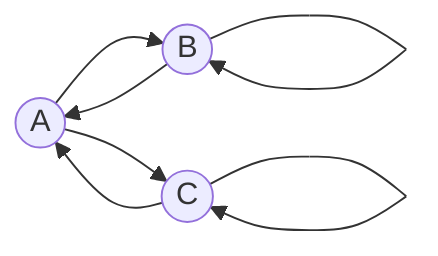

# Задание №7. Вариант 3

## Маршруты в ориентированном графе и взаимные рекуррентные соотношения

### 1. Условие задачи

Дан ориентированный граф с вершинами $A$, $B$ и $C$ и дугами
$A\to B$, $A\to C$, $B\to A$, $B\to B$, $C\to A$, $C\to C$.
Петли $B\to B$ и $C\to C$ учитываются как один шаг маршрута.

Требуется найти явную формулу числа маршрутов длины $n$, которые начинаются в вершине $B$ и заканчиваются в вершине $B$.

### 2. Система взаимных рекуррентных соотношений

Для $n\geqslant 0$ обозначим:

- $a_n$ — число маршрутов длины $n$ из $B$ в $A$;
- $b_n$ — число маршрутов длины $n$ из $B$ в $B$;
- $c_n$ — число маршрутов длины $n$ из $B$ в $C$.

Искомая последовательность — $b_n$.

Маршрут нулевой длины не содержит дуг и остаётся в начальной вершине. Поэтому

$$
\boxed{a_0=0,\qquad b_0=1,\qquad c_0=0.}
$$

Рассмотрим последнюю дугу маршрута длины $n+1$:

1. В вершину $A$ можно прийти только из $B$ или из $C$. Поэтому $a_{n+1}=b_n+c_n$.
2. В вершину $B$ можно прийти только из $A$ или по петле из $B$. Поэтому $b_{n+1}=a_n+b_n$.
3. В вершину $C$ можно прийти только из $A$ или по петле из $C$. Поэтому $c_{n+1}=a_n+c_n$.

Получена система взаимных рекуррентных соотношений:

$$
\boxed{
\begin{cases}
a_{n+1}=b_n+c_n,\\
b_{n+1}=a_n+b_n,\\
c_{n+1}=a_n+c_n,
\end{cases}\qquad n\geqslant0.}
$$

### 3. Сведение системы к одному однородному рекуррентному соотношению

Из второго соотношения выражаем $a_n$:

$$
a_n=b_{n+1}-b_n. \tag{1}
$$

Заменяя $n$ на $n+1$, получаем

$$
a_{n+1}=b_{n+2}-b_{n+1}. \tag{2}
$$

По первому соотношению $a_{n+1}=b_n+c_n$. С учётом (2):

$$
b_{n+2}-b_{n+1}=b_n+c_n,
$$

откуда

$$
c_n=b_{n+2}-b_{n+1}-b_n. \tag{3}
$$

Теперь используем третье соотношение $c_{n+1}=a_n+c_n$ и подставляем выражения (1) и (3):

$$
c_{n+1}=(b_{n+1}-b_n)+(b_{n+2}-b_{n+1}-b_n)=b_{n+2}-2b_n. \tag{4}
$$

С другой стороны, заменив $n$ на $n+1$ в (3), имеем

$$
c_{n+1}=b_{n+3}-b_{n+2}-b_{n+1}. \tag{5}
$$

Приравниваем правые части (4) и (5):

$$
b_{n+3}-b_{n+2}-b_{n+1}=b_{n+2}-2b_n.
$$

Перенося все слагаемые в левую часть, получаем искомое **однородное линейное рекуррентное соотношение третьего порядка с постоянными коэффициентами**:

$$
\boxed{b_{n+3}-2b_{n+2}-b_{n+1}+2b_n=0,\qquad n\geqslant0.}
$$

### 4. Характеристическое уравнение

Ищем решение в виде $b_n=\lambda^n$ при $\lambda\ne0$. Подставляем его в полученное рекуррентное соотношение:

$$
\lambda^{n+3}-2\lambda^{n+2}-\lambda^{n+1}+2\lambda^n=0.
$$

Делим на $\lambda^n$:

$$
\lambda^3-2\lambda^2-\lambda+2=0.
$$

Группируем слагаемые:

$$
\begin{aligned}
\lambda^3-2\lambda^2-\lambda+2
&=\lambda^2(\lambda-2)-(\lambda-2)\\
&=(\lambda-2)(\lambda^2-1)\\
&=(\lambda-2)(\lambda-1)(\lambda+1).
\end{aligned}
$$

Следовательно, характеристическое уравнение имеет три различных корня:

$$
\boxed{\lambda_1=2,\qquad \lambda_2=1,\qquad \lambda_3=-1.}
$$

### 5. Общее решение и определение постоянных

Так как корни характеристического уравнения попарно различны, общее решение имеет вид

$$
\boxed{b_n=A_1\cdot2^n+A_2\cdot1^n+A_3\cdot(-1)^n.}
$$

Для определения трёх постоянных нужны три начальных значения. Из системы рекуррентных соотношений:

$$
\begin{aligned}
b_0&=1,\\
b_1&=a_0+b_0=0+1=1,\\
a_1&=b_0+c_0=1+0=1,\\
b_2&=a_1+b_1=1+1=2.
\end{aligned}
$$

Подставляя $n=0,1,2$ в общее решение, получаем систему:

$$
\begin{cases}
A_1+A_2+A_3=1,\\
2A_1+A_2-A_3=1,\\
4A_1+A_2+A_3=2.
\end{cases}
$$

Вычитая первое уравнение из третьего, находим

$$
3A_1=1,\qquad A_1=\frac13.
$$

Из первого и второго уравнений:

$$
A_2+A_3=\frac23,\qquad A_2-A_3=\frac13.
$$

Следовательно,

$$
\boxed{A_1=\frac13,\qquad A_2=\frac12,\qquad A_3=\frac16.}
$$

### 6. Явная формула числа маршрутов

Подставляем найденные постоянные в общее решение:

$$
\begin{aligned}
b_n
&=\frac13\cdot2^n+\frac12+\frac16\cdot(-1)^n\\
&=\frac{2^{n+1}+3+(-1)^n}{6}.
\end{aligned}
$$

Таким образом, **число маршрутов длины $n$ из $B$ в $B$** равно

$$
\boxed{\displaystyle b_n=\frac{2^{n+1}+3+(-1)^n}{6},\qquad n\geqslant0.}
$$

### 7. Проверка на небольших значениях $n$

Проверим формулу с помощью непосредственного подсчёта по рекуррентной системе:

| Длина маршрута $n$ | Число маршрутов $b_n$ по системе | Значение явной формулы |
|:---:|:---:|:---:|
| 0 | 1 | $(2+3+1)/6=1$ |
| 1 | 1 | $(4+3-1)/6=1$ |
| 2 | 2 | $(8+3+1)/6=2$ |
| 3 | 3 | $(16+3-1)/6=3$ |
| 4 | 6 | $(32+3+1)/6=6$ |
| 5 | 11 | $(64+3-1)/6=11$ |

Например, для $n=2$ возможны два маршрута: $B\to B\to B$ и $B\to A\to B$. Для $n=3$ — три маршрута: $B\to B\to B\to B$, $B\to B\to A\to B$ и $B\to A\to B\to B$. Эти значения совпадают с формулой.

### Ответ

$$
\boxed{\displaystyle \frac{2^{n+1}+3+(-1)^n}{6},\qquad n\geqslant0.}
$$
