# Задание №10

## Выполнение связанных работ в кратчайший срок

В каждом варианте дано условие одной задачи теории расписаний.

Необходимо построить расписание, выполняемое в кратчайшие сроки:

1. Выбрать алгоритм решения и обосновать выбор, сопоставив условие с постановкой соответствующей модельной задачи.
2. Применить выбранный алгоритм; в решении отобразить ход выполнения с **подробными комментариями**.
3. Указать длительность полученного расписания.
4. Вывести расписание в виде диаграммы Ганта.
5. Привести интерпретацию условия из выбранной предметной области. Она должна сохранять все особенности варианта: что означают работы, их длительности, число исполнителей и то, что каждый может выполнить любую работу, запрет прерываний, все отношения предшествования и цель — выполнить работы в кратчайший срок. Совпадающие в таблице длительности остаются совпадающими и в интерпретации, различающиеся — различающимися. Дополнительные баллы начисляются за лучшие интерпретации, если они оригинальны: похожая интерпретация другой команды, предложенная позже, на дополнительные баллы не претендует.

Диаграмму Ганта можно оформить блоком Mermaid `gantt` либо аккуратной таблицей по образцу лекции. В Mermaid удобно трактовать условные единицы как часы (`dateFormat HH:mm`).

```mermaid
gantt
    title Пример диаграммы Ганта
    dateFormat HH:mm
    axisFormat %H:%M
    section Исполнитель 1
    A :a1, 00:00, 3h
    B :a2, after a1, 2h
    section Исполнитель 2
    C :c1, 00:00, 4h
```

**Решение должно содержать номер варианта и подробное пошаговое обоснование.**

Решение необходимо изложить в терминах, обозначениях и приёмах, введённых на лекциях и семинарах. Подмена этого метода аппаратом, который в курсе не изучался, не принимается, в том числе при верном ответе.

Генеративные модели (ИИ) нельзя использовать ни для решения задачи, ни для оформления решения. **Использование ИИ, а также плагиат являются нарушением академических норм и ведут к обнулению оценки.**

Решение нужно оформить в отдельной ветке в файле `ИмяКоманды.md`, расположенном в каталоге `Задание 10` данного репозитория.

## Оформление и отправка решения

1. Обновить локальную ветку `main` (`git pull`).
2. От ветки `main` создать ветку `ИмяКоманды-task-10`, заменив `ИмяКоманды` названием команды.
3. Добавить в каталог `Задание 10` файл `ИмяКоманды.md` с решением.
4. Зафиксировать изменения (`git commit`) и отправить ветку в репозиторий (`git push`).
5. Создать pull request: **base** — `main`, **compare** — `ИмяКоманды-task-10`.

Полезные материалы:

- [руководство по оформлению Markdown](https://gist.github.com/Jekins/2bf2d0638163f1294637);
- [формулы LaTeX в Markdown](https://grammarware.net/text/syutkin/MathInLaTeX.pdf);
- [диаграммы Mermaid](https://habr.com/ru/articles/652867/).

## Варианты выполнения задания

### Вариант 1

Имеется 12 работ и 2 универсальных исполнителя. Прерывания запрещены.

| | A | B | C | D | E | F | G | H | I | J | K | L |
| --- | :---: | :---: | :---: | :---: | :---: | :---: | :---: | :---: | :---: | :---: | :---: | :---: |
| Длительность | 1 | 1 | 1 | 1 | 1 | 1 | 1 | 1 | 1 | 1 | 1 | 1 |

Предшествование задано таблицей: в каждом столбце последующее задание не начинается, пока не завершено предшествующее.

| Предшествующее задание | A | A | B | B | E | E | E | G | G | I | K | K | L |
| --- | :---: | :---: | :---: | :---: | :---: | :---: | :---: | :---: | :---: | :---: | :---: | :---: | :---: |
| Последующее задание | G | K | A | E | A | J | L | C | D | C | F | I | H |

Постройте расписание выполнения всех работ в кратчайшие сроки.

### Вариант 2

Имеется 12 работ и 12 универсальных исполнителей. Прерывания запрещены.

| | A | B | C | D | E | F | G | H | I | J | K | L |
| --- | :---: | :---: | :---: | :---: | :---: | :---: | :---: | :---: | :---: | :---: | :---: | :---: |
| Длительность | 2 | 2 | 2 | 2 | 2 | 2 | 2 | 2 | 2 | 2 | 2 | 2 |

Предшествование задано таблицей: в каждом столбце последующее задание не начинается, пока не завершено предшествующее.

| Предшествующее задание | A | A | B | C | E | E | F | F | H | J | L |
| --- | :---: | :---: | :---: | :---: | :---: | :---: | :---: | :---: | :---: | :---: | :---: |
| Последующее задание | G | K | E | A | C | D | B | H | G | L | I |

Постройте расписание выполнения всех работ в кратчайшие сроки.

### Вариант 3

Имеется 13 работ и 2 универсальных исполнителя. Прерывания запрещены.

| | A | B | C | D | E | F | G | H | I | J | K | L | M |
| --- | :---: | :---: | :---: | :---: | :---: | :---: | :---: | :---: | :---: | :---: | :---: | :---: | :---: |
| Длительность | 1 | 1 | 1 | 1 | 1 | 1 | 1 | 1 | 1 | 1 | 1 | 1 | 1 |

Предшествование задано таблицей: в каждом столбце последующее задание не начинается, пока не завершено предшествующее.

| Предшествующее задание | A | B | C | D | E | F | G | H | I | K | L | M |
| --- | :---: | :---: | :---: | :---: | :---: | :---: | :---: | :---: | :---: | :---: | :---: | :---: |
| Последующее задание | C | J | E | L | K | C | D | I | K | J | I | J |

Постройте расписание выполнения всех работ в кратчайшие сроки.

### Вариант 4

Имеется 13 работ и 2 универсальных исполнителя. Прерывания запрещены.

| | A | B | C | D | E | F | G | H | I | J | K | L | M |
| --- | :---: | :---: | :---: | :---: | :---: | :---: | :---: | :---: | :---: | :---: | :---: | :---: | :---: |
| Длительность | 2 | 2 | 2 | 2 | 2 | 2 | 2 | 2 | 2 | 2 | 2 | 2 | 2 |

Предшествование задано таблицей: в каждом столбце последующее задание не начинается, пока не завершено предшествующее.

| Предшествующее задание | A | A | C | C | C | D | D | F | F | L | L | M | M | M |
| --- | :---: | :---: | :---: | :---: | :---: | :---: | :---: | :---: | :---: | :---: | :---: | :---: | :---: | :---: |
| Последующее задание | G | K | B | E | L | C | F | H | M | I | J | B | C | I |

Постройте расписание выполнения всех работ в кратчайшие сроки.

### Вариант 5

Имеется 13 работ и 13 универсальных исполнителей. Прерывания запрещены.

| | A | B | C | D | E | F | G | H | I | J | K | L | M |
| --- | :---: | :---: | :---: | :---: | :---: | :---: | :---: | :---: | :---: | :---: | :---: | :---: | :---: |
| Длительность | 1 | 1 | 1 | 1 | 1 | 1 | 1 | 1 | 1 | 1 | 1 | 1 | 1 |

Предшествование задано таблицей: в каждом столбце последующее задание не начинается, пока не завершено предшествующее.

| Предшествующее задание | B | B | D | E | E | G | G | H | H | J | K | K | M | M |
| --- | :---: | :---: | :---: | :---: | :---: | :---: | :---: | :---: | :---: | :---: | :---: | :---: | :---: | :---: |
| Последующее задание | D | M | I | A | K | J | K | A | G | L | C | F | E | H |

Постройте расписание выполнения всех работ в кратчайшие сроки.

### Вариант 6

Имеется 14 работ и 2 универсальных исполнителя. Прерывания запрещены.

| | A | B | C | D | E | F | G | H | I | J | K | L | M | N |
| --- | :---: | :---: | :---: | :---: | :---: | :---: | :---: | :---: | :---: | :---: | :---: | :---: | :---: | :---: |
| Длительность | 2 | 2 | 2 | 2 | 2 | 2 | 2 | 2 | 2 | 2 | 2 | 2 | 2 | 2 |

Предшествование задано таблицей: в каждом столбце последующее задание не начинается, пока не завершено предшествующее.

| Предшествующее задание | A | C | D | E | G | H | I | J | K | L | M | N |
| --- | :---: | :---: | :---: | :---: | :---: | :---: | :---: | :---: | :---: | :---: | :---: | :---: |
| Последующее задание | M | N | F | I | D | F | B | H | F | N | C | D |

Постройте расписание выполнения всех работ в кратчайшие сроки.

### Вариант 7

Имеется 14 работ и 2 универсальных исполнителя. Прерывания запрещены.

| | A | B | C | D | E | F | G | H | I | J | K | L | M | N |
| --- | :---: | :---: | :---: | :---: | :---: | :---: | :---: | :---: | :---: | :---: | :---: | :---: | :---: | :---: |
| Длительность | 1 | 1 | 1 | 1 | 1 | 1 | 1 | 1 | 1 | 1 | 1 | 1 | 1 | 1 |

Предшествование задано таблицей: в каждом столбце последующее задание не начинается, пока не завершено предшествующее.

| Предшествующее задание | A | D | D | E | F | F | G | G | G | G | I | I | L | M | M | M |
| --- | :---: | :---: | :---: | :---: | :---: | :---: | :---: | :---: | :---: | :---: | :---: | :---: | :---: | :---: | :---: | :---: |
| Последующее задание | K | B | L | N | C | J | B | D | F | I | E | H | J | A | G | H |

Постройте расписание выполнения всех работ в кратчайшие сроки.

### Вариант 8

Имеется 14 работ и 14 универсальных исполнителей. Прерывания запрещены.

| | A | B | C | D | E | F | G | H | I | J | K | L | M | N |
| --- | :---: | :---: | :---: | :---: | :---: | :---: | :---: | :---: | :---: | :---: | :---: | :---: | :---: | :---: |
| Длительность | 1 | 2 | 2 | 2 | 2 | 4 | 2 | 2 | 2 | 2 | 2 | 2 | 2 | 2 |

Предшествование задано таблицей: в каждом столбце последующее задание не начинается, пока не завершено предшествующее.

| Предшествующее задание | A | B | B | C | D | F | F | F | G | G | G | I | N | N |
| --- | :---: | :---: | :---: | :---: | :---: | :---: | :---: | :---: | :---: | :---: | :---: | :---: | :---: | :---: |
| Последующее задание | E | D | N | M | E | C | H | L | B | I | K | J | A | J |

Постройте расписание выполнения всех работ в кратчайшие сроки.

### Вариант 9

Имеется 15 работ и 2 универсальных исполнителя. Прерывания запрещены.

| | A | B | C | D | E | F | G | H | I | J | K | L | M | N | O |
| --- | :---: | :---: | :---: | :---: | :---: | :---: | :---: | :---: | :---: | :---: | :---: | :---: | :---: | :---: | :---: |
| Длительность | 1 | 1 | 1 | 1 | 1 | 1 | 1 | 1 | 1 | 1 | 1 | 1 | 1 | 1 | 1 |

Предшествование задано таблицей: в каждом столбце последующее задание не начинается, пока не завершено предшествующее.

| Предшествующее задание | A | B | C | D | E | F | H | I | J | K | L | M | N | O |
| --- | :---: | :---: | :---: | :---: | :---: | :---: | :---: | :---: | :---: | :---: | :---: | :---: | :---: | :---: |
| Последующее задание | L | N | O | G | I | G | C | K | N | A | O | H | O | G |

Постройте расписание выполнения всех работ в кратчайшие сроки.

### Вариант 10

Имеется 15 работ и 2 универсальных исполнителя. Прерывания запрещены.

| | A | B | C | D | E | F | G | H | I | J | K | L | M | N | O |
| --- | :---: | :---: | :---: | :---: | :---: | :---: | :---: | :---: | :---: | :---: | :---: | :---: | :---: | :---: | :---: |
| Длительность | 2 | 2 | 2 | 2 | 2 | 2 | 2 | 2 | 2 | 2 | 2 | 2 | 2 | 2 | 2 |

Предшествование задано таблицей: в каждом столбце последующее задание не начинается, пока не завершено предшествующее.

| Предшествующее задание | A | A | A | A | D | E | E | E | J | J | J | L | L | N | N | O |
| --- | :---: | :---: | :---: | :---: | :---: | :---: | :---: | :---: | :---: | :---: | :---: | :---: | :---: | :---: | :---: | :---: |
| Последующее задание | C | H | I | J | I | F | K | M | D | G | N | B | O | L | O | H |

Постройте расписание выполнения всех работ в кратчайшие сроки.

### Вариант 11

Имеется 15 работ и 15 универсальных исполнителей. Прерывания запрещены.

| | A | B | C | D | E | F | G | H | I | J | K | L | M | N | O |
| --- | :---: | :---: | :---: | :---: | :---: | :---: | :---: | :---: | :---: | :---: | :---: | :---: | :---: | :---: | :---: |
| Длительность | 1 | 1 | 1 | 2 | 1 | 1 | 1 | 1 | 1 | 2 | 1 | 1 | 1 | 1 | 1 |

Предшествование задано таблицей: в каждом столбце последующее задание не начинается, пока не завершено предшествующее.

| Предшествующее задание | A | A | C | C | D | D | D | E | F | H | I | I | I | K | N | O | O |
| --- | :---: | :---: | :---: | :---: | :---: | :---: | :---: | :---: | :---: | :---: | :---: | :---: | :---: | :---: | :---: | :---: | :---: |
| Последующее задание | D | K | G | M | E | L | M | H | O | J | B | H | N | C | K | A | I |

Постройте расписание выполнения всех работ в кратчайшие сроки.

### Вариант 12

Имеется 16 работ и 3 универсальных исполнителя. Прерывания запрещены.

| | A | B | C | D | E | F | G | H | I | J | K | L | M | N | O | P |
| --- | :---: | :---: | :---: | :---: | :---: | :---: | :---: | :---: | :---: | :---: | :---: | :---: | :---: | :---: | :---: | :---: |
| Длительность | 2 | 2 | 2 | 2 | 2 | 2 | 2 | 2 | 2 | 2 | 2 | 2 | 2 | 2 | 2 | 2 |

Предшествование задано таблицей: в каждом столбце последующее задание не начинается, пока не завершено предшествующее.

| Предшествующее задание | A | B | C | D | E | G | I | J | K | L | M | N | O | P |
| --- | :---: | :---: | :---: | :---: | :---: | :---: | :---: | :---: | :---: | :---: | :---: | :---: | :---: | :---: |
| Последующее задание | D | H | F | F | N | B | D | A | H | A | O | A | H | J |

Постройте расписание выполнения всех работ в кратчайшие сроки.

### Вариант 13

Имеется 16 работ и 2 универсальных исполнителя. Прерывания запрещены.

| | A | B | C | D | E | F | G | H | I | J | K | L | M | N | O | P |
| --- | :---: | :---: | :---: | :---: | :---: | :---: | :---: | :---: | :---: | :---: | :---: | :---: | :---: | :---: | :---: | :---: |
| Длительность | 1 | 1 | 1 | 1 | 1 | 1 | 1 | 1 | 1 | 1 | 1 | 1 | 1 | 1 | 1 | 1 |

Предшествование задано таблицей: в каждом столбце последующее задание не начинается, пока не завершено предшествующее.

| Предшествующее задание | A | A | C | C | C | F | F | H | J | K | K | M | O | O | O | O | P |
| --- | :---: | :---: | :---: | :---: | :---: | :---: | :---: | :---: | :---: | :---: | :---: | :---: | :---: | :---: | :---: | :---: | :---: |
| Последующее задание | K | M | B | D | L | L | P | I | E | F | J | K | A | C | H | N | G |

Постройте расписание выполнения всех работ в кратчайшие сроки.
