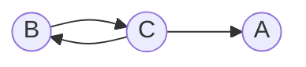

# Задание 7. Вариант 1

Дан ориентированный граф:

Маршрут длины $n$ — это последовательность из $n$ дуг графа. Найдите
количество различных маршрутов длины $n$, которые начинаются в вершине $B$
и заканчиваются в вершине $A$.

## 1. Составим рекуррентные соотношения

Пусть:

- $a_n$ - количество маршрутов длины $n$ из $B$ в $A$
- $b_n$ - количество маршрутов длины $n$ из $B$ в $B$
- $c_n$ - количество маршрутов длины $n$ из $B$ в $C$

Нам нужно найти формулу для $a_n$

Рассмотрим, из каких вершин можно сделать последний переход. В вершину $A$ можно прийти только из $C$, в вершину $B$ тоже только из $C$, а в вершину $C$ только из $B$

Поэтому для $n >= 1$ получаем систему:

$$
\begin{cases}
a_n = c_{n-1}\\
b_n = c_{n-1}\\
c_n = b_{n-1}
\end{cases}
$$

При $n=0$ мы находимся в начальной вершине $B$, ещё не сделав ни одного перехода. Поэтому:

$$
a_0=0
$$
$$
b_0=1
$$
$$
c_0=0
$$

Из первых двух равенств системы видно, что $a_n=b_n$ при $n>=1$

Теперь выразим $a_n$ через предыдущие значения:

$$
a_n=c_{n-1}=b_{n-2}=a_{n-2}
$$

Последнее равенство верно при $n>=3$, так как $a_k=b_k$ для $k>=1$

Получили одно рекуррентное соотношение:

$$
a_n=a_{n-2},\quad n>=3
$$

Оно линейное, однородное, с постоянными коэффициентами, глубины 2

Найдём два начальных значения:

- $a_1=0$, так как дуги из $B$ в $A$ нет;
- $a_2=1$, так как есть ровно один маршрут из $B$ в $C$ в $A$

## 2. Характеристическое уравнение

Подставим $a_n=\lambda^n$:

$$
\lambda^n=\lambda^{n-2}
$$

Разделим на $\lambda^{n-2}$ при $\lambda\ne0$:

$$
\lambda^2=1
$$

$$
\lambda^2-1=0
$$

$$
(\lambda-1)(\lambda+1)=0
$$

Корни разные: $\lambda_1=1$ и $\lambda_2=-1$

Поэтому общее решение имеет вид:

$$
a_n=A_1\cdot1^n+A_2\cdot(-1)^n
$$

## 3. Найдём коэффициенты

Подставим начальные значения $a_1=0$ и $a_2=1$:

$$
\begin{cases}
0=A_1-A_2\\
1=A_1+A_2
\end{cases}
$$

Сложим уравнения: $1=2A_1$, откуда $A_1=\frac12$. Из первого уравнения $A_2=\frac12$

Подставляем эти коэффициенты в общее решение:

$$
a_n=\frac12\cdot1^n+\frac12\cdot(-1)^n
$$

Таким образом, искомая формула:

$$
a_n=\frac{1+(-1)^n}{2},\quad n>=1
$$

## 4. Проверка

Проверим первые несколько значений:

- $n=1$: $a_1=0$. Прямого перехода из $B$ в $A$ нет
- $n=2$: $a_2=1$. Маршрут из $B$ в $C$ в $A$
- $n=3$: $a_3=0$. Маршрута из трёх дуг нет.
- $n=4$: $a_4=1$. Маршрут из $B$ в $C$ в $B$ в $C$ в $A$

Получается, что при чётном положительном $n$ существует один маршрут, а при нечётном маршрутов нет.

**Ответ:** $a_n=\frac{1+(-1)^n}{2}$ при $n>=1$ При $n=0$ маршрутов из $B$ в $A$ нет, то есть $a_0=0$
