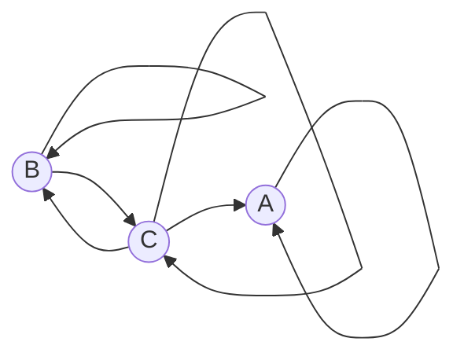

# Задание №7

## Маршруты в ориентированном графе и взаимные рекуррентные соотношения

Команда Nexus. Вариант 9.

Дан ориентированный граф:

Нужно найти число маршрутов длины $n$, которые начинаются в вершине $B$ и заканчиваются в вершине $A$. Прохождение петли считается одним шагом.

## 1. Составить систему из рекуррентных соотношений и свести её к одному однородному линейному рекуррентному соотношению

Пусть $a_n$ это число маршрутов длины $n$ из $B$ в $A$, $b_n$ из $B$ в $B$, $c_n$ из $B$ в $C$. Ищем $a_n$.

Маршрут длины $n$ кончается одной дугой. Число маршрутов в вершину равно сумме чисел маршрутов длины $n-1$ в те вершины, из которых эта дуга выходит.

В $A$ входят петля $A \to A$ и дуга $C \to A$. Других входящих дуг нет, поэтому при $n \ge 2$

$$
a_n = a_{n-1} + c_{n-1}.
$$

В $B$ входят петля $B \to B$ и дуга $C \to B$, поэтому при $n \ge 2$

$$
b_n = b_{n-1} + c_{n-1}.
$$

В $C$ входят дуга $B \to C$ и петля $C \to C$. Дуги $A \to C$ нет, поэтому при $n \ge 2$

$$
c_n = b_{n-1} + c_{n-1}.
$$

Длину 1 читаем по дугам из $B$. Выходят петля $B \to B$ и дуга $B \to C$. Дуги $B \to A$ нет, поэтому

$$
a_1 = 0, \qquad b_1 = 1, \qquad c_1 = 1.
$$

Правые части уравнений для $b_n$ и $c_n$ совпадают. При $n = 1$ значения тоже равны. Если $b_{n-1} = c_{n-1}$, то и $b_n$, и $c_n$ равны одной и той же сумме $b_{n-1} + c_{n-1}$. Значит $b_n = c_n$ при всех $n \ge 1$.

Тогда при $n \ge 2$

$$
b_n = 2b_{n-1}.
$$

Считаем первые шаги:

$$
b_2 = 2b_1 = 2 \cdot 1 = 2 = 2^1,
$$

$$
b_3 = 2b_2 = 2 \cdot 2 = 4 = 2^2.
$$

Каждый следующий номер умножает предыдущий на 2, поэтому степень растёт на 1. Вместе с $b_1 = 2^0$ получаем $b_n = 2^{n-1}$. Так как $c_n = b_n$,

$$
c_n = 2^{n-1}.
$$

Подставляем $c_{n-1}$ в уравнение для $a_n$. При $n \ge 2$

$$
a_n = a_{n-1} + 2^{n-2}.
$$

Слагаемое $2^{n-2}$ мешает однородности. Перепишем равенство так:

$$
a_n - a_{n-1} = 2^{n-2}, \qquad n \ge 2.
$$

То же для предыдущего номера, уже при $n \ge 3$:

$$
a_{n-1} - a_{n-2} = 2^{n-3}.
$$

Правая часть первого равенства вдвое больше правой части второго, потому что $2^{n-2} = 2 \cdot 2^{n-3}$. Значит

$$
a_n - a_{n-1} = 2(a_{n-1} - a_{n-2}),
$$

$$
a_n = 3a_{n-1} - 2a_{n-2}, \qquad n \ge 3.
$$

Значение $a_1$ уже есть: $a_1 = 0$.

Для $a_2$ перечислим маршруты длины 2 из $B$ в $A$. Подходит только $B \to C \to A$. Маршрут $B \to B \to A$ не существует: нет дуги $B \to A$. Значит $a_2 = 1$.

По системе то же самое: $a_2 = a_1 + c_1 = 0 + 1 = 1$.

Проверка на $n = 3$. По рекуррентности $3 \cdot 1 - 2 \cdot 0 = 3$. По системе $a_3 = a_2 + c_2 = 1 + 2^{1} = 3$.

## 2. Составить и решить характеристическое уравнение

$$
a_n - 3a_{n-1} + 2a_{n-2} = 0.
$$

Ищем решение в виде $a_n = \lambda^n$. Подставляем в соотношение:

$$
\lambda^n = 3\lambda^{n-1} - 2\lambda^{n-2}.
$$

Делим на $\lambda^{n-2}$:

$$
\lambda^2 = 3\lambda - 2,
$$

$$
\lambda^2 - 3\lambda + 2 = 0,
$$

$$
(\lambda - 1)(\lambda - 2) = 0.
$$

$$
\lambda_1 = 1, \qquad \lambda_2 = 2.
$$

Корни разные, поэтому

$$
a_n = A_1 \cdot 1^n + A_2 \cdot 2^n.
$$

## 3. Найти формулу для числа указанных маршрутов

Подставляем $a_1 = 0$ и $a_2 = 1$.

$$
A_1 \cdot 1^1 + A_2 \cdot 2^1 = A_1 + 2A_2 = 0,
$$

$$
A_1 \cdot 1^2 + A_2 \cdot 2^2 = A_1 + 4A_2 = 1.
$$

Вычитаем первое из второго: $2A_2 = 1$, значит $A_2 = \dfrac{1}{2}$.

Из первого уравнения $A_1 + 2 \cdot \dfrac{1}{2} = 0$, значит $A_1 = -1$.

$$
a_n = -1 \cdot 1^n + \dfrac{1}{2} \cdot 2^n.
$$

Здесь $1^n = 1$, а $\dfrac{1}{2} \cdot 2^n = 2^{n-1}$, поэтому

$$
a_n = 2^{n-1} - 1.
$$

Проверка по уже найденным значениям:

$$
a_1 = 2^0 - 1 = 0, \qquad a_2 = 2^1 - 1 = 1, \qquad a_3 = 2^2 - 1 = 3.
$$

**Ответ:** число маршрутов длины $n$ из $B$ в $A$ равно $2^{n-1} - 1$ при $n \ge 1$.
