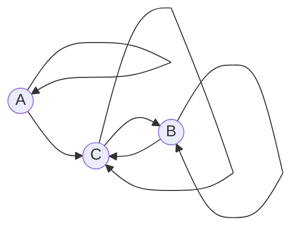

### Вариант 10 Команда pickme

Дан ориентированный граф:

Маршрут длины n — это последовательность из n дуг графа; прохождение петли также считается одним шагом. Найдите количество различных маршрутов длины n , которые начинаются в вершине A и заканчиваются в вершине B .

### Составим систему уравнений из рекуррентных соотношений

$$

\begin{aligned}

a_n &= a_{n-1}, \\

b_n &= b_{n-1} + c_{n-1}, \\

c_n &= a_{n-1} + b_{n-1} + c_{n-1},

\end{aligned}

$$

где $a_n$ — количество путей из А в А, $b_n$ — из А в B и $c_n$ — из А в С.
### Вычислим руками начальные значения для всех вершин

$$
\begin{aligned}
a_1 &= 1 \\
b_1 &= 0 \\
c_1 &= 1
\end{aligned}
$$

### Решим составленную систему

Так как $a_n = a_{n-1}$, а $a_1 = 1$, то $a_n = 1$

Тогда:

$$

\begin{aligned}

b_n &= b_{n-1} + c_{n-1}, \\

c_n &= 1 + b_{n-1} + c_{n-1},

\end{aligned}

$$

Заметим, что

$c_n = 1 + b_n$

Следовательно: 

$$

\begin{aligned}
b_n &= b_{n-1} + 1 + b_{n-1}\\ 
b_n &= 2 \cdot b_{n-1} + 1
\end{aligned}

$$

Но так как в итоговом рекуррентном соотношении присутствует свободный член, перейти к однородному характеристическому уравнению мы не можем. Поэтому, запишем уравнение для $n-1$:

$$

\begin{aligned}
b_n &= 2 \cdot b_{n-1} + 1\\ 
b_{n-1} &= 2 \cdot b_{n-2} + 1
\end{aligned}

$$

Теперь вычтем из первого уравнения второе:

$$

b_n - b_{n-1} = 2 \cdot b_{n-1} - 2 \cdot b_{n - 2} + 1 - 1\\ 
b_n = 3 \cdot b_{n-1} - 2 \cdot b_{n-2}

$$

На этом шаге уже можно спокойно переходить к характ. уравнению.

### Выведем характеристическое уравнение
Пусть $b_n = \lambda^n$

Тогда:

$$

\lambda^n = 3 \cdot \lambda^{n-1} - 2 \cdot \lambda^{n-2}

$$

Разделим обе части на $\lambda^{n-2}$:

$$

\lambda^2 - 3 \cdot \lambda + 2 = 0 \\
\lambda^2 - \lambda - 2 \cdot \lambda + 2 = 0 \\
\lambda \cdot (\lambda - 1) - 2 \cdot (\lambda - 1) = 0 \\
(\lambda - 1) \cdot (\lambda - 2) = 0

$$

Таким образом, корни 1 и 2.

### Общее решение
$$

b_n = A_1 \cdot 1^n  + A_2 \cdot 2^n

$$

Вычислим руками первые два значения ($b_1$ и $b_2$)

$b_1$ = 0 (нет прямого пути из А в B, а через C длина становится слишком большой)

$b_2$ = 1 (единственный путь А -> C -> B)

Тогда можно составить систему уравнений:

$$

\begin{cases}
A_1 \cdot 1^1 + A_2 \cdot 2^1 = 0 \\
A_1 \cdot 1^2 + A_2 \cdot 2^2 = 1
\end{cases}

=>

\begin{cases}
A_1 + 2 \cdot A_2 = 0 \\
A_1 + 4 \cdot A_2 = 1
\end{cases}

$$

Вычтем первое уравнение из второго:

$2 \cdot A_2 = 1$, значит, $A_2 = 0.5$

Подставим в первое уравнение:

$A_1 + 2 \cdot 0.5 = 0$

$A_1 = -1$

Таким образом, уравнение принимает вид:

$$

b_n = -1 \cdot 1^n + \frac{2^n}{2} \\ 
b_n = -1 + 2^{n-1} \\
b_n = 2^{n - 1} - 1

$$

### Проверка
n = 1

$b_1 = 2^{1-1} - 1 = 2^0 - 1 = 1 - 1 = 0$ 

Всё верно. Почему это так я рассказывал выше.

n = 2

$b_2 = 2^{2 - 1} - 1 = 2^1 - 1 = 2 - 1 = 1$

Также верно.

n = 3

$b_3 = 2^{3 - 1} - 1 = 2^2 - 1 = 4 - 1 = 3$

Ручным перебором были найдены только эти три варианта:

А -> A  -> C -> B

A -> C -> C -> B

A -> C-> B -> B. 

Больше вариантов не существует.

n = 4

$b_4 = 2^{4-1} - 1 = 2^3 - 1 = 8 - 1 = 7$

Ручным перебором были найдены все 7 вариантов:

​A -> A -> A -> C -> B

A -> A -> C -> C -> B

A -> A -> C -> B -> B

A -> C -> B -> B -> B

A -> C -> B -> C -> B

A -> C -> C -> C -> B

A -> C -> C -> B -> B.​

Больше вариантов нет.

Таким образом, ответом точно (проверено и перепроверено) будет:

$$

b_n = 2^{n - 1} - 1

$$
