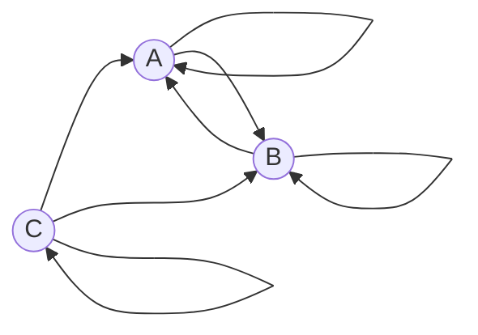

### Команда Problems - Задание 7 Вариант 2:

Дан ориентированный граф:

Маршрут длины $n$ — это последовательность из $n$ дуг графа; прохождение
петли также считается одним шагом. Найдите количество различных маршрутов
длины $n$, которые начинаются в вершине $C$ и заканчиваются в вершине $B$.

### Составить систему из рекуррентных соотношений и свести её к одному однородному линейному рекуррентному соотношению.

Введём обозначения:
- $a_n$ = количество маршрутов длиной $n$, которые начинаются в $C$ и заканчиваются в $A$
- $b_n$ = количество маршрутов длиной $n$, которые начинаются в $C$ и заканчиваются в $B$
- $c_n$ = количество маршрутов длиной $n$, которые начинаются в $C$ и заканчиваются в $C$

Используя комбинаторный принцип сложения составим систему рекуррентных соотношений:

$$
\begin{cases}
a_n = a_{n-1} + b_{n-1} + c_{n-1}, \\
b_n = a_{n-1} + b_{n-1} + c_{n-1}, \\
c_n = c_{n-1}
\end{cases}
$$

Зададим начальные условия - количество маршрутов длиной в один переход:
- $a_1 = 1$
- $b_1 = 1, b_2 = 3$
- $c_1 = 1$

В системе рекуррентных соотношений правые части $a_n$ и $b_n$ совпадают. Следовательно, мы можем сделать вывод:

$$
a_n = b_n
$$

Поскольку $c_n = c_{n-1}$, можем сделать вывод, что: $$ c_n = 1$$

Подставим начальные условия в соотношение для $b_n$:

$$
b_n = b_{n-1} + b_{n-1} + 1 = 2 \cdot b_{n-1} + 1
$$

Для того, чтобы избавиться от свободного члена, вычитаем уравнение с пониженным $n$:

$$
b_n - b_{n-1} = 2 \cdot b_{n-1} - 2 \cdot b_{n-2}
$$

После упрощения получаем линейное однородное рекуррентное соотношение глубины $2$:

$$
b_n = 3 \cdot b_{n-1} - 2 \cdot b_{n-2}
$$

Дополним начальные условия:

$$
b_1 = 1 \\
b_2 = 3
$$

### Составить и решить характеристическое уравнение.

Подставим $ b_n = \lambda^n $:

$$
\lambda^n = 3 \cdot \lambda^{n-1} - 2 \cdot \lambda^{n-2}
$$

Поделим на наименьшее значение степени $\lambda^{n-2}$:

$$
\lambda^2 - 3\cdot \lambda + 2 = 0
$$

Найдем корни квадратного уравнения по теореме Виета:

$$
\lambda_1 = 1 \\
\lambda_2 = 2
$$

### Найти формулу для числа указанных маршрутов.

Поскольку $ \lambda_1 \neq \lambda_2 $, то формула общего решения будет:

$$
b_n = A_1 \cdot 2^n + A_2 \cdot 1^n
$$

Для нахождения неопределенных коэффициентов составим систему уравнений, используя начальные условия:

$$
\begin{cases}
1 = A_1 \cdot 2 + A_2, \\
3 = A_1 \cdot 4 + A_2 
\end{cases}
$$

Вычтем первое уравнение из второго:

$$
3 - 1 = (A_1 \cdot 4 + A_2) - (A_1 \cdot 2 + A_2), \\
2 = A_1 \cdot 2, \\
$$
$$
A_1 = 1
$$

Подставим $A_1$ в первое уравнение:
$$
A_2 = 1 - A_1 \cdot 2 = 1 - 2 = -1
$$

На основе вычислений получаем формулу для вычисления количества маршрутов длины $n$:

$$
b_n = 2^n - 1
$$

Выполним проверку для количества маршрутов длины $n = 3$:
$$
b_3 = 2^3 - 1 = 8 - 1 = 7
$$

Маршруты $b_3$:
1. $C->C->C->B$
2. $C->C->B->B$
3. $C->C->A->B$
4. $C->B->B->B$
5. $C->B->A->B$
6. $C->A->B->B$
7. $C->A->A->B$

### Ответ
Формула для нахождения количества различных маршрутов длины $n$, которые начинаются в вершине $C$ и заканчиваются в вершине $B$:
$$
b_n = 2^n - 1
$$