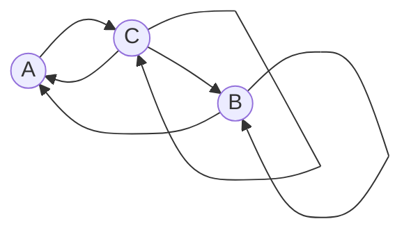

# Задание 7. Вариант 5

Дан ориентированный граф с вершинами $A$, $B$, $C$:

Маршрут длины $n$ — это последовательность из $n$ дуг графа; прохождение петли также считается одним шагом. Найдите количество различных маршрутов длины $n$, которые начинаются в вершине $C$ и заканчиваются в вершине $A$.

Дуги графа: $A \to C$, $C \to A$, $C \to B$, $B \to A$ и две петли: $C \to C$ и $B \to B$. Дуг $A \to B$, $B \to C$ и петли в $A$ нет.

**Требуется:** найти явную формулу для числа маршрутов длины $n$, которые начинаются в вершине $C$ и заканчиваются в вершине $A$.

---

## 1. Составим систему из рекуррентных соотношений и сведем ее к одному однородному линейному рекуррентному соотношению.

### Обозначения

Все маршруты начинаются в вершине $C$. Введём:

- $a_n$ — количество маршрутов длины $n$, которые начинаются в $C$ и заканчиваются в $A$ (искомая величина);
- $b_n$ — количество маршрутов длины $n$, которые начинаются в $C$ и заканчиваются в $B$;
- $c_n$ — количество маршрутов длины $n$, которые начинаются в $C$ и заканчиваются в $C$.

### Система соотношений

Используем комбинаторный принцип сложения. Посмотрим на последнюю дугу маршрута. Пусть $V$ — любая из вершин $A$, $B$, $C$, и маршрут длины $n$ заканчивается в $V$. Тогда его последняя дуга входит в $V$, то есть начинается в одной из вершин, из которых в $V$ ведёт дуга. Всё, что идёт до этой дуги, — это маршрут длины $n-1$ из $C$ в такую вершину.

Поэтому, чтобы посчитать маршруты длины $n$ в $V$, берём каждую вершину, из которой в $V$ ведёт дуга, и складываем числа маршрутов длины $n-1$, заканчивающихся в этих вершинах. Если у $V$ есть петля, то сама $V$ тоже входит в этот список.

Входящие дуги:

- в $A$ входят дуги из $C$ и из $B$ (дуги $A \to A$ нет);
- в $B$ входят дуга из $C$ и петля из $B$ (дуги $A \to B$ нет);
- в $C$ входят дуга из $A$ и петля из $C$ (дуги $B \to C$ нет).

Получаем систему взаимных рекуррентных соотношений ($n \ge 2$):

$$
\begin{cases}
a_n = b_{n-1} + c_{n-1},\\
b_n = b_{n-1} + c_{n-1},\\
c_n = a_{n-1} + c_{n-1}.
\end{cases}
$$

### Начальные условия

Количество маршрутов длины один читается прямо по графу. Из $C$ выходят три дуги:

- $a_1 = 1$ (дуга $C \to A$);
- $b_1 = 1$ (дуга $C \to B$);
- $c_1 = 1$ (петля $C \to C$).

### Сведение системы к одному соотношению

Работать с системой из трёх неизвестных неудобно, поэтому исключаем лишние переменные.

**Первое наблюдение.** Правые части первого и второго уравнений совпадают, и начальные условия совпадают: $a_1 = b_1 = 1$. Следовательно,

$$a_n = b_n \quad \text{при всех } n \ge 1.$$

**Второе наблюдение.** Подставим $b_{n-1} = a_{n-1}$ в первое уравнение:

$$a_n = a_{n-1} + c_{n-1}.$$

Правая часть совпала с правой частью третьего уравнения $c_n = a_{n-1} + c_{n-1}$. Начальные условия тоже совпадают: $a_1 = c_1 = 1$. Следовательно,

$$a_n = c_n \quad \text{при всех } n \ge 1.$$

**Результат.** Итак, $a_n = b_n = c_n$ при всех $n \ge 1$. Заменим в уравнении $a_n = a_{n-1} + c_{n-1}$ величину $c_{n-1}$ на $a_{n-1}$:

$$a_n = 2a_{n-1}, \qquad n \ge 2.$$

Это линейное однородное рекуррентное соотношение с постоянными коэффициентами глубины $1$. Дальше про маршруты можно забыть и решать его известным алгоритмом.

---

## 2. Составим и решим характеристическое уравнение.

Подставим $a_n = \lambda^n$:

$$\lambda^n = 2\lambda^{n-1}.$$

Поделим на наименьшую степень $\lambda^{n-1}$ (при этом $\lambda \ne 0$) и получим характеристическое уравнение

$$\lambda - 2 = 0 \quad\Rightarrow\quad \lambda_1 = 2.$$

Корень один, кратность 1 (соотношение глубины 1), поэтому общее решение имеет вид

$$a_n = A_1 \cdot 2^n.$$

---

## 3. Найдем формулу для числа указанных маршрутов.

Одна неизвестная константа — нужно одно начальное условие: $a_1 = 1$.

$$A_1 \cdot 2^1 = 1 \quad\Rightarrow\quad A_1 = \frac{1}{2}.$$

Подставляем в общее решение:

$$a_n = \frac12 \cdot 2^n = 2^{n-1}.$$

### Проверка по графу

Проверяем формулу: считаем маршруты длины $2$, $3$ и $4$ из $C$ в $A$, выписывая сами маршруты.

**$n = 2$.** По формуле $2^{1} = 2$.  
Маршруты: $C \to C \to A$, $C \to B \to A$.  
Других нет: из $A$ можно уйти только в $C$.

**$n = 3$.** По формуле $2^{2} = 4$, по соотношению $a_3 = 2a_2 = 4$. 
Маршруты:

1. $C \to A \to C \to A$
2. $C \to C \to C \to A$
3. $C \to B \to B \to A$
4. $C \to C \to B \to A$

Ровно 4 маршрута.

**$n = 4$.** По формуле $2^{3} = 8$, по соотношению $a_4 = 2a_3 = 8$. Последняя дуга в $A$ идёт из $B$ или из $C$, поэтому перед ней стоят маршруты длины $3$, заканчивающиеся в $C$ или в $B$.  
Маршруты:

1. $C \to B \to A \to C \to A$
2. $C \to C \to A \to C \to A$
3. $C \to A \to C \to C \to A$
4. $C \to C \to C \to C \to A$
5. $C \to A \to C \to B \to A$
6. $C \to C \to C \to B \to A$
7. $C \to B \to B \to B \to A$
8. $C \to C \to B \to B \to A$

Ровно 8 маршрутов. 

---

## Ответ

Формула для нахождения количества различных маршрутов длины $n$, которые начинаются в вершине $C$ и заканчиваются в вершине $A$:

$$a_n = 2^{\,n-1}, \qquad n \ge 1.$$
