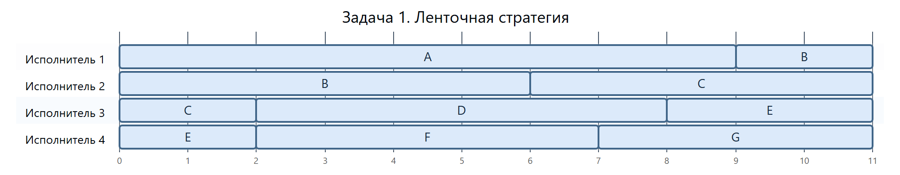
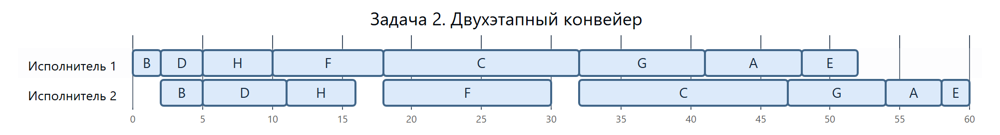

# Задание № 8. Вариант 4 — Algorithmica

## Задача 1

**Задача 1.** Имеется 7 независимых заданий и 4 универсальных исполнителя. Прерывания допускаются.

Длительности заданий:

| | $A$ | $B$ | $C$ | $D$ | $E$ | $F$ | $G$ |
| --- | :---: | :---: | :---: | :---: | :---: | :---: | :---: |
| Длительность | 9 | 8 | 7 | 6 | 5 | 5 | 4 |

Постройте расписание выполнения всех заданий в кратчайшие сроки.

### Выбор метода и нижняя оценка

Применим **ленточную стратегию**. Все задания доступны с начала работы и независимы. Любой исполнитель может продолжить прерванное задание с того места, где остановился другой. В каждый момент над одним заданием работает не более одного исполнителя.

Обозначим длительность расписания через $T$. За это время четыре исполнителя могут выполнить не более $4T$ единиц работы. Суммарная длительность заданий равна $9+8+7+6+5+5+4=44$, поэтому $T\ge 44/4=11$. Кроме того, самое длинное задание $A$ занимает 9 единиц, так что $T\ge 9$. Получаем нижнюю оценку $T\ge\max(11,9)=11$. Построим расписание такой длины.

### Построение расписания

Выложим задания на ленту подряд в порядке $A,B,C,D,E,F,G$. Границы между заданиями пройдут в точках $9,17,24,30,35,40$, конец ленты окажется в точке $44$. Разрежем ленту в точках $11,22,33$. Каждую из четырёх полос положим на шкалу своего исполнителя так, чтобы её левый край соответствовал времени $0$. Запись $[s,e)$ означает, что исполнитель занят с момента $s$ до момента $e$ и освобождается в $e$.

| Исполнитель | Полоса ленты | Как заполняется рабочее время |
| :---: | :---: | --- |
| 1 | $[0,11)$ | $A$ занимает $[0,9)$. До разреза остаются 2 единицы для $B$ на $[9,11)$. |
| 2 | $[11,22)$ | На $B$ приходятся ещё $8-2=6$ единиц на $[0,6)$. Следующие 5 единиц, $[6,11)$, занимает $C$. |
| 3 | $[22,33)$ | На $C$ остаются $7-5=2$ единицы на $[0,2)$. Затем $D$ целиком занимает $[2,8)$, а на $E$ приходятся 3 единицы на $[8,11)$. |
| 4 | $[33,44)$ | Ещё $5-3=2$ единицы для $E$ занимают $[0,2)$. Затем $F$ занимает $[2,7)$, а $G$ — $[7,11)$. |

### Диаграмма Ганта

Горизонтальная шкала показывает время в условных единицах от 0 до 11. Каждая строка показывает работу одного исполнителя.

```mermaid
---
displayMode: compact
config:
  gantt:
    leftPadding: 115
    rightPadding: 25
    barHeight: 26
    fontSize: 14
    sectionFontSize: 13
---
gantt
    title Задача 1. Ленточная стратегия
    dateFormat x
    axisFormat %-L
    tickInterval 1millisecond
    todayMarker off

    section Исполнитель 1
    A :t1a1, 0, 9ms
    B :t1b1, 9, 2ms
    section Исполнитель 2
    B :t1b2, 0, 6ms
    C :t1c2, 6, 5ms
    section Исполнитель 3
    C :t1c3, 0, 2ms
    D :t1d3, 2, 6ms
    E :t1e3, 8, 3ms
    section Исполнитель 4
    E :t1e4, 0, 2ms
    F :t1f4, 2, 5ms
    G :t1g4, 7, 4ms
```

Диаграмма в формате Mermaid

Проверим разрезанные задания в хронологическом порядке. Задание $B$ выполняется на $[0,6)$ и $[9,11)$, задание $C$ — на $[0,2)$ и $[6,11)$, задание $E$ — на $[0,2)$ и $[8,11)$. У каждого задания интервалы не пересекаются и в сумме дают требуемые 8, 7 и 5 единиц соответственно. Все четыре исполнителя заканчивают в момент 11. Нижняя оценка достигнута, поэтому **минимальная длительность расписания равна 11**.

### Предметная интерпретация

Музей механической музыки готовит к выставке семь перфорированных рулонов для пианолы. Четыре реставратора сверяют отверстия на рулонах с нотами. В таблице указано число часов проверки каждого рулона. Любой реставратор читает все семь партитур. Место остановки отмечают закладкой, поэтому другой реставратор может продолжить с той же ноты без повторной проверки. Каждый оригинал установлен на одной ручной перемотке, и работать с ним в один момент может только один человек.

## Задача 2

**Задача 2.** Имеется 8 независимых заданий, каждое из которых состоит из двух последовательных этапов, и 2 исполнителя: первый выполняет только первый этап каждого задания, второй — только второй. Прерывания запрещены.

Длительности этапов:

| | $A$ | $B$ | $C$ | $D$ | $E$ | $F$ | $G$ | $H$ |
| --- | :---: | :---: | :---: | :---: | :---: | :---: | :---: | :---: |
| Первый этап | 7 | 2 | 14 | 3 | 4 | 8 | 9 | 5 |
| Второй этап | 4 | 3 | 15 | 6 | 2 | 12 | 7 | 5 |

Постройте расписание выполнения всех заданий в кратчайшие сроки.

### Выбор метода и порядок заданий

Это конвейерная задача для двух исполнителей. У всех заданий один маршрут, от первого исполнителя ко второму. Этапы выполняются без прерываний, а разные задания могут одновременно находиться на разных этапах. Для такой постановки **алгоритм Джонсона** даёт оптимальный порядок заданий, общий для обоих исполнителей.

Оставим в очереди восемь свободных мест. На каждом шаге выбираем наименьшую длительность среди обоих этапов всех ещё не поставленных в очередь заданий. Если минимум относится к первому этапу, занимаем крайнее свободное место слева, если ко второму — справа. После этого исключаем из рассмотрения оба этапа выбранного задания. При равенстве можно взять любой из минимумов.

| Шаг | Выбранный минимум | Куда ставим задание | Очередь после шага |
| :---: | --- | --- | --- |
| 1 | 2, первый этап $B$ | Есть равный минимум у $E$. Выбираем $B$ и ставим на место 1 слева. | `B · · · · · · ·` |
| 2 | 2, второй этап $E$ | Занимаем крайнее правое место 8. | `B · · · · · · E` |
| 3 | 3, первый этап $D$ | Первое свободное место слева — 2. | `B D · · · · · E` |
| 4 | 4, второй этап $A$ | Первое свободное место справа — 7. | `B D · · · · A E` |
| 5 | 5, оба этапа $H$ | Выбираем первый этап и ставим $H$ слева на место 3. | `B D H · · · A E` |
| 6 | 7, второй этап $G$ | Справа свободно место 6. | `B D H · · G A E` |
| 7 | 8, первый этап $F$ | Слева свободно место 4. | `B D H F · G A E` |
| 8 | 14, первый этап $C$ | Осталось одно место, 5. | `B D H F C G A E` |

### Расчёт времени

Первый исполнитель начинает в момент 0 и берёт следующее задание сразу после предыдущего. Для второго исполнителя нужны одновременно два условия. Первый этап текущего задания должен закончиться, а сам второй исполнитель должен освободиться. Поэтому начало второго этапа равно максимуму этих двух моментов. К началу прибавляем длительность второго этапа.

| Задание | Первый исполнитель | Начало у второго | Второй исполнитель |
| :---: | :---: | :---: | :---: |
| $B$ | $[0,2)$ | $\max(2,0)=2$ | $[2,5)$ |
| $D$ | $[2,5)$ | $\max(5,5)=5$ | $[5,11)$ |
| $H$ | $[5,10)$ | $\max(10,11)=11$ | $[11,16)$ |
| $F$ | $[10,18)$ | $\max(18,16)=18$ | $[18,30)$ |
| $C$ | $[18,32)$ | $\max(32,30)=32$ | $[32,47)$ |
| $G$ | $[32,41)$ | $\max(41,47)=47$ | $[47,54)$ |
| $A$ | $[41,48)$ | $\max(48,54)=54$ | $[54,58)$ |
| $E$ | $[48,52)$ | $\max(52,58)=58$ | $[58,60)$ |

Например, $H$ готово к передаче в момент 10, но второй исполнитель до момента 11 занят заданием $D$. При переходе от $H$ к $F$ ждёт уже сам исполнитель. Он свободен в момент 16, а первый этап $F$ заканчивается только в момент 18.

### Диаграмма Ганта

Горизонтальная шкала показывает время в условных единицах от 0 до 60. Промежутки между полосами показывают простой. У второго исполнителя это $[0,2)$, $[16,18)$ и $[30,32)$.

```mermaid
---
displayMode: compact
config:
  gantt:
    leftPadding: 115
    rightPadding: 25
    barHeight: 26
    fontSize: 14
    sectionFontSize: 13
---
gantt
    title Задача 2. Двухэтапный конвейер
    dateFormat x
    axisFormat %-L
    tickInterval 5millisecond
    todayMarker off

    section Исполнитель 1
    B :t2b1, 0, 2ms
    D :t2d1, 2, 3ms
    H :t2h1, 5, 5ms
    F :t2f1, 10, 8ms
    C :t2c1, 18, 14ms
    G :t2g1, 32, 9ms
    A :t2a1, 41, 7ms
    E :t2e1, 48, 4ms
    section Исполнитель 2
    B :t2b2, 2, 3ms
    D :t2d2, 5, 6ms
    H :t2h2, 11, 5ms
    F :t2f2, 18, 12ms
    C :t2c2, 32, 15ms
    G :t2g2, 47, 7ms
    A :t2a2, 54, 4ms
    E :t2e2, 58, 2ms
```

Диаграмма в формате Mermaid

### Проверка оптимальности

Полученное расписание заканчивается в момент 60. Проверим, почему даже при другой очереди завершить работу раньше нельзя. Рассмотрим момент начала второго этапа $C$ в любом допустимом расписании. К этому моменту первый исполнитель уже выполнил первый этап $C$ и первые этапы всех заданий, которые второй успел обработать до $C$. Начиная с этого момента второй исполнитель должен выполнить второй этап $C$ и вторые этапы всех заданий, которые идут у него после $C$.

Так в нижнюю оценку входят оба этапа $C$ и по одному этапу каждого другого задания. Какой бы этап ни вошёл, его длительность не меньше минимума из двух длительностей этого задания. Для $A,B,D,E,F,G,H$ эти минимумы равны соответственно $4,2,3,2,8,7,5$. Следовательно,

$$
T \ge (14+15)+(4+2+3+2+8+7+5)=60.
$$

Очередь $B,D,H,F,C,G,A,E$ достигает этой границы. **Минимальная длительность расписания равна 60**.

### Предметная интерпретация

Театр теней готовит восемь ажурных трафаретов. Для каждого лазерный станок сначала вырезает рисунок из листа, затем на световом стенде записывают контрольную проекцию полного оборота трафарета. Длительности резки и съёмки в минутах указаны в условии. У станка одно рабочее поле, у стенда один держатель. Каждый цикл проходит без пауз. Готовый трафарет может ждать съёмки, пока станок уже вырезает следующий рисунок.
