# Задание 8. Вариант 5

Команда: Auto

## Задача 1

### Условие

9 заданий, у каждого 2 этапа. Первый исполнитель делает только первый этап, второй - только второй. Прерывания запрещены.

| | A | B | C | D | E | F | G | H | I |
|---|---|---|---|---|---|---|---|---|---|
| Первый этап (a) | 10 | 5 | 1 | 9 | 2 | 6 | 8 | 4 | 15 |
| Второй этап (b) | 13 | 2 | 3 | 5 | 5 | 6 | 3 | 7 | 16 |

### 1. Выбор алгоритма

Это конвейерная задача для двух исполнителей: каждое задание сначала идет на первого исполнителя, потом на второго, порядок этапов везде одинаковый, прерывать нельзя, нужно закончить все как можно быстрее. Для такой задачи используем алгоритм Джонсона.

Алгоритм Джонсона:

1. Делим задания на две группы: $N_1$ - где $a_i \le b_i$, и $N_2$ - где $a_i > b_i$.
2. $N_1$ сортируем по возрастанию $a_i$, $N_2$ - по убыванию $b_i$.
3. Сначала выполняем задания из $N_1$, потом из $N_2$.

### 2. Решение

Шаг 1. Делим на группы:

| Задание | a | b | Сравнение | Группа |
|---|---|---|---|---|
| A | 10 | 13 | 10 <= 13 | N1 |
| B | 5 | 2 | 5 > 2 | N2 |
| C | 1 | 3 | 1 <= 3 | N1 |
| D | 9 | 5 | 9 > 5 | N2 |
| E | 2 | 5 | 2 <= 5 | N1 |
| F | 6 | 6 | 6 <= 6 | N1 |
| G | 8 | 3 | 8 > 3 | N2 |
| H | 4 | 7 | 4 <= 7 | N1 |
| I | 15 | 16 | 15 <= 16 | N1 |

У F этапы равны (6 и 6), поэтому его можно поставить в любую группу, на ответ это не влияет. Поставили в N1.

Шаг 2. Сортируем группы:

- N1 по возрастанию a: C (1), E (2), H (4), F (6), A (10), I (15)
- N2 по убыванию b: D (5), G (3), B (2)

Шаг 3. Порядок выполнения: C, E, H, F, A, I, D, G, B.

Шаг 4. Считаем время. Первый исполнитель работает без перерывов. Второй берет задание, когда первый его уже доделал и сам второй освободился, т.е. начало = max(конец 1 этапа; конец предыдущего задания у второго).

| Задание | a | Исп. 1 | b | Исп. 2 | Простой исп. 2 |
|---|---|---|---|---|---|
| C | 1 | 0 - 1 | 3 | 1 - 4 | 1 |
| E | 2 | 1 - 3 | 5 | 4 - 9 | 0 |
| H | 4 | 3 - 7 | 7 | 9 - 16 | 0 |
| F | 6 | 7 - 13 | 6 | 16 - 22 | 0 |
| A | 10 | 13 - 23 | 13 | 23 - 36 | 1 |
| I | 15 | 23 - 38 | 16 | 38 - 54 | 2 |
| D | 9 | 38 - 47 | 5 | 54 - 59 | 0 |
| G | 8 | 47 - 55 | 3 | 59 - 62 | 0 |
| B | 5 | 55 - 60 | 2 | 62 - 64 | 0 |

Проверка: второй исполнитель работает 60 и простаивает 1 + 1 + 2 = 4, всего 64.

### 3. Длительность расписания

T = 64

### 4. Диаграмма Ганта

Здесь 1 у.е. = 1 минута, потому что 64 часа не влезают в формат HH:mm.

```mermaid
gantt
    title Задача 1, T = 64
    dateFormat HH:mm
    axisFormat %H:%M
    section Исполнитель 1
    C : 00:00, 00:01
    E : 00:01, 00:03
    H : 00:03, 00:07
    F : 00:07, 00:13
    A : 00:13, 00:23
    I : 00:23, 00:38
    D : 00:38, 00:47
    G : 00:47, 00:55
    B : 00:55, 01:00
    section Исполнитель 2
    C : 00:01, 00:04
    E : 00:04, 00:09
    H : 00:09, 00:16
    F : 00:16, 00:22
    A : 00:23, 00:36
    I : 00:38, 00:54
    D : 00:54, 00:59
    G : 00:59, 01:02
    B : 01:02, 01:04
```

### 5. Интерпретация

Ютуб-канал, нужно сделать 9 роликов (A - I). Сначала оператор снимает ролик, потом монтажер его монтирует. Монтировать неснятый ролик нельзя. Прерывать съемку тоже нельзя: свет и локацию потом заново не выставишь. Время в часах. Нужно, чтобы все ролики были готовы как можно раньше - получается через 64 часа.

## Задача 2

### Условие

6 заданий, 3 универсальных исполнителя, прерывания можно.

| | A | B | C | D | E | F |
|---|---|---|---|---|---|---|
| Длительность (p) | 8 | 7 | 6 | 4 | 3 | 2 |

### 1. Выбор алгоритма

Исполнители одинаковые (любое задание любой делает за одно и то же время), задания независимые, прерывания разрешены, но одно задание не может делаться двумя исполнителями одновременно. Это задача для ленточной стратегии (алгоритм Мак-Нотона).

Длительность расписания:

$$T = \max\left(\max p_i;\ \frac{\sum p_i}{m}\right)$$

Меньше нельзя: самое длинное задание не разделить между двумя исполнителями одновременно, а всю работу быстрее чем за сумму / m не сделать.

### 2. Решение

Шаг 1. Сумма = 8 + 7 + 6 + 4 + 3 + 2 = 30, m = 3, самое длинное = 8.

T = max(8; 30 / 3) = max(8; 10) = 10

Шаг 2. Ставим задания подряд в одну ленту (порядок любой, взяли A-F):

| Задание | A | B | C | D | E | F |
|---|---|---|---|---|---|---|
| На ленте | 0 - 8 | 8 - 15 | 15 - 21 | 21 - 25 | 25 - 28 | 28 - 30 |

Шаг 3. Режем ленту на куски по 10: [0; 10] - первому исполнителю, [10; 20] - второму, [20; 30] - третьему (сдвигаем к нулю).

Разрезы попали в B и C, поэтому они прерываются и переходят на другого исполнителя:

- B: 2 ед. у первого (8 - 10) и 5 ед. у второго (0 - 5)
- C: 5 ед. у второго (5 - 10) и 1 ед. у третьего (0 - 1)

Части одного задания по времени не пересекаются, т.к. каждое задание не длиннее T.

Итог:

| Исполнитель | Задания |
|---|---|
| 1 | A: 0 - 8, B: 8 - 10 |
| 2 | B: 0 - 5, C: 5 - 10 |
| 3 | C: 0 - 1, D: 1 - 5, E: 5 - 8, F: 8 - 10 |

Все исполнители заняты от 0 до 10 без простоев.

### 3. Длительность расписания

T = 10

### 4. Диаграмма Ганта

В диаграмме 1 у.е. показана как 1 час.

```mermaid
gantt
    title Задача 2, T = 10
    dateFormat HH:mm
    axisFormat %H:%M
    section Исполнитель 1
    A : 00:00, 08:00
    B (часть 1) : 08:00, 10:00
    section Исполнитель 2
    B (часть 2) : 00:00, 05:00
    C (часть 1) : 05:00, 10:00
    section Исполнитель 3
    C (часть 2) : 00:00, 01:00
    D : 01:00, 05:00
    E : 05:00, 08:00
    F : 08:00, 10:00
```

### 5. Интерпретация

В зале 3 одинаковые беговые дорожки и 6 спортсменов (A - F). Каждому нужно набегать свое время: A - 8 у.е., B - 7 и т.д. (1 у.е. = 10 минут). Спортсмен может перейти на другую дорожку и добегать там, но бежать сразу по двум дорожкам нельзя. Все закончат через 10 у.е., т.е. через 100 минут.
