# Задание №8

**Вариант 1. Команда Cherepaha_Two.**

## Задача 1. Конвейерная задача

Даны 7 независимых заданий, каждое из которых состоит из двух последовательных этапов. Первый исполнитель выполняет только первые этапы, а второй выполняет только вторые. Прерывания запрещены. Требуется построить расписание минимальной длительности.

| Задание | A | B | C | D | E | F | G |
| --- | :---: | :---: | :---: | :---: | :---: | :---: | :---: |
| Первый этап $a_i$ | 2 | 3 | 9 | 12 | 7 | 6 | 4 |
| Второй этап $b_i$ | 5 | 4 | 10 | 12 | 5 | 3 | 1 |

### Шаг 1. Выбрать алгоритм

Проверю, подходит ли алгоритм Джонсона к условиям этой задачи.

| Характеристика | В условии |
| --- | --- |
| 1. Количество заданий | 7, известно заранее |
| 2. Длительности | Два этапа у каждого задания, длительности различаются |
| 3. Независимость | Задания независимы, этапы одного задания идут последовательно |
| 4. Прерывания | Запрещены |
| 5. Исполнители | Ровно 2 |
| 6. Специализация | Первый выполняет только первый этап, второй выполняет только второй |
| 7. Производительность и оплата | Дополнительно не учитываются |
| 8. Цель | Минимальная общая длительность расписания |

Исполнителей ровно два, причём каждый выполняет только свой этап. Все семь заданий независимы, но второй этап каждого начинается только после завершения первого. Прерывания запрещены, поэтому можно менять только порядок выполнения заданий. Выбираю **алгоритм Джонсона**, так как он позволяет найти оптимальную последовательность для двух исполнителей с такими этапами.

### Шаг 2. Найти оптимальный порядок заданий

Обозначу длительности этапов задания $i$ через $a_i$ и $b_i$.

Разделю задания на две группы:
- **Первая группа.** $a_i \le b_i$. Сортирую по возрастанию $a_i$.
- **Вторая группа.** $a_i > b_i$. Сортирую по убыванию $b_i$.

После сортировки получаю следующую таблицу:

| Группа | Задания с длительностями $(a_i,b_i)$ | После сортировки |
| --- | --- | --- |
| $a_i \le b_i$ | $A(2,5)$, $B(3,4)$, $C(9,10)$, $D(12,12)$ | $A, B, C, D$ |
| $a_i > b_i$ | $E(7,5)$, $F(6,3)$, $G(4,1)$ | $E, F, G$ |

Задание $D$ имеет равные длительности этапов, поэтому отношу его к первой группе по правилу $a_i \le b_i$.

Объединю две группы, сначала первую, затем вторую:

$$
\boxed{(A,\ B,\ C,\ D,\ E,\ F,\ G)}
$$

Полученная последовательность совпадает с исходным порядком заданий.

### Шаг 3. Построить расписание

Первый исполнитель выполняет задания подряд. Второй может начать этап только тогда, когда **первый этап этого задания закончен** и **второй исполнитель свободен**.

Начало второго этапа найду по формуле:

$$
\text{Начало второго этапа} = \max\bigl(\text{конец первого этапа},\;\text{конец предыдущего второго этапа}\bigr).
$$

Например, для задания $C$ первый этап закончится в момент $14$, а второй исполнитель освободится после $B$ в момент $11$. Поэтому второй этап $C$ начнётся в момент $\max(14,11)=14$.

| Задание | Первый этап | Второй этап |
| :---: | :---: | :---: |
| $A$ | $[0,2)$ | $[2,7)$ |
| $B$ | $[2,5)$ | $[7,11)$ |
| $C$ | $[5,14)$ | $[14,24)$ |
| $D$ | $[14,26)$ | $[26,38)$ |
| $E$ | $[26,33)$ | $[38,43)$ |
| $F$ | $[33,39)$ | $[43,46)$ |
| $G$ | $[39,43)$ | $[46,47)$ |

Запись $[2,7)$ означает выполнение с момента $2$ до момента $7$ (длительность $5$).

### Шаг 4. Найти минимальную длительность

Сначала найду суммарное время работы первого исполнителя:

$$
2+3+9+12+7+6+4=43.
$$

Он заканчивает в момент $43$. Второй исполнитель заканчивает последнее задание $G$ в момент $47$.

Проверю результат по второму исполнителю. Сумма длительностей вторых этапов равна:

$$
5+4+10+12+5+3+1=40.
$$

Второй исполнитель простаивает в интервалах $[0,2)$, $[11,14)$ и $[24,26)$, то есть $2+3+2=7$ единиц. Следовательно:

$$
T=40+7=\boxed{47}.
$$

Это **минимальная длительность**, так как алгоритм Джонсона даёт оптимальный порядок для двухэтапного конвейера.

### Шаг 5. Диаграмма Ганта

На диаграмме исполнители выделены разными цветами:
* **Исполнитель 1** — синий (`:active`)
* **Исполнитель 2** — серый (`:done`)

Пустые промежутки на шкале второго исполнителя отражают естественные технологические простои ($[0,2)$, $[11,14)$, $[24,26)$).

```mermaid
gantt
    title Задача 1. Конвейерная задача (47 единиц)
    dateFormat HH:mm
    axisFormat %H:%M
    tickInterval 4hour
    todayMarker off

    section Исполнитель 1
    A (2)  :active, a1, 00:00, 2h
    B (3)  :active, b1, after a1, 3h
    C (9)  :active, c1, after b1, 9h
    D (12) :active, d1, after c1, 12h
    E (7)  :active, e1, after d1, 7h
    F (6)  :active, f1, after e1, 6h
    G (4)  :active, g1, after f1, 4h

    section Исполнитель 2
    A (5)  :done, a2, after a1, 5h
    B (4)  :done, b2, after a2, 4h
    C (10) :done, c2, after c1, 10h
    D (12) :done, d2, after d1, 12h
    E (5)  :done, e2, after d2, 5h
    F (3)  :done, f2, after e2, 3h
    G (1)  :done, g2, after f2, 1h
```

### Шаг 6. Предметная интерпретация

**Подготовка и анализ семи видеозаписей с промышленных камер.**

В лаборатории есть семь независимых видеозаписей от $A$ до $G$. Каждую сначала нужно перекодировать в единый формат на **сервере 1**, а затем обработать алгоритмом распознавания событий на **сервере 2**. Первый сервер выполняет только перекодирование, второй выполняет только распознавание.

Серверы могут работать параллельно над **разными** видеозаписями, но анализ конкретной записи начинается только после полного перекодирования. Операции не прерываются, поскольку при остановке обработку пришлось бы запускать заново. Продолжительности обеих операций для каждого файла заданы таблицей; дополнительных затрат времени не учитываем.

Нужно закончить обработку всех семи записей как можно раньше. По алгоритму Джонсона выбираю порядок $(A, B, C, D, E, F, G)$. Тогда сервер 1 заканчивает в момент $43$, а сервер 2 заканчивает в момент $47$. Таким образом, весь набор готов через **47 условных единиц времени**.

---

## Задача 2. Ленточная стратегия

Даны 6 независимых заданий и 4 универсальных исполнителя. Прерывания разрешены. Требуется получить расписание минимальной длительности.

| Задание | A | B | C | D | E | F |
| --- | :---: | :---: | :---: | :---: | :---: | :---: |
| Длительность $t_i$ | 8 | 7 | 6 | 6 | 5 | 4 |

### Шаг 1. Выбрать алгоритм

Проверю, подходит ли ленточная стратегия к условиям второй задачи.

| Характеристика | В условии |
| --- | --- |
| 1. Количество заданий | 6, известно заранее |
| 2. Длительности | Длительности заданы отдельно, некоторые совпадают |
| 3. Независимость | Задания независимы |
| 4. Прерывания | Разрешены, работу можно продолжить без потери результата |
| 5. Исполнители | Ровно 4 |
| 6. Специализация | Все исполнители универсальны |
| 7. Производительность и оплата | Исполнители одинаковы; дополнительные различия не учитываются |
| 8. Цель | Минимальная общая длительность расписания |

Все шесть заданий независимы. Четыре одинаковых по возможностям исполнителя могут выполнять любое из них, а прерванное задание можно продолжить без потери выполненной работы. Выбираю **ленточную стратегию**, потому что задания можно разделять на части и передавать между четырьмя универсальными исполнителями без потери сделанной работы. При этом одно задание не выполняется двумя исполнителями одновременно.

### Шаг 2. Вычислить оптимальную длительность

Для $k$ исполнителей и заданий длительностями $t_1,\ldots,t_n$ использую формулу:

$$
T_{opt}=\max\left\{\max_i t_i,\;\frac{t_1+\dots+t_n}{k}\right\}.
$$

Самое длинное задание длится $8$ единиц. Сумма всех длительностей равна:

$$
8+7+6+6+5+4=36.
$$

Исполнителей $k=4$, поэтому получаю:

$$
T_{opt}=\max\left\{8,\frac{36}{4}\right\}
=\max\{8,9\}=\boxed{9}.
$$

Меньше $9$ единиц не получится: за это время четырём исполнителям нужно выполнить все $36$ единиц работы.

### Шаг 3. Составить и разрезать ленту

Расположу задания **в исходном порядке** $(A, B, C, D, E, F)$ на одной ленте.

| Задание | $A$ | $B$ | $C$ | $D$ | $E$ | $F$ |
| --- | :---: | :---: | :---: | :---: | :---: | :---: |
| Длительность | 8 | 7 | 6 | 6 | 5 | 4 |
| Место на ленте | $[0,8)$ | $[8,15)$ | $[15,21)$ | $[21,27)$ | $[27,32)$ | $[32,36)$ |

Общая длина ленты равна $36$. Разрежу её на четыре части длиной $9$ в точках:

$$
\boxed{9,\quad18,\quad27}.
$$

- Разрез в точке $9$ делит $B$ на части $1$ и $6$.
- Разрез в точке $18$ делит $C$ на части $3$ и $3$.
- Разрез в точке $27$ проходит **между** $D$ и $E$, поэтому их прерывать не нужно.

### Шаг 4. Распределить части между исполнителями

Каждый исполнитель начинает свою часть ленты с момента $0$.

| Исполнитель | Выполнение заданий | Общая загрузка |
| :---: | --- | :---: |
| 1 | $A:[0,8)$, часть $B:[8,9)$ | $8+1=9$ |
| 2 | часть $B:[0,6)$, часть $C:[6,9)$ | $6+3=9$ |
| 3 | часть $C:[0,3)$, $D:[3,9)$ | $3+6=9$ |
| 4 | $E:[0,5)$, $F:[5,9)$ | $5+4=9$ |

Проверю, как выполняются прерванные задания:
- Задание $B$ сначала выполняет исполнитель 2 на $[0,6)$, затем исполнитель 1 на $[8,9)$. Всего $6+1=7$.
- Задание $C$ сначала выполняет исполнитель 3 на $[0,3)$, затем исполнитель 2 на $[6,9)$. Всего $3+3=6$.

Части одного задания **не выполняются одновременно**. Все четыре исполнителя заняты с момента $0$ до момента $9$, простоев нет. Значит, найденная нижняя граница $T_{opt}=9$ достигнута, и расписание оптимально.

### Шаг 5. Диаграмма Ганта

На диаграмме каждый исполнитель имеет свой персональный цвет:
* **Исполнитель 1** — синий (`:active`)
* **Исполнитель 2** — красный / коралловый (`:crit`)
* **Исполнитель 3** — серый (`:done`)
* **Исполнитель 4** — базовый цвет темы

```mermaid
gantt
    title Задача 2. Ленточная стратегия (9 единиц)
    dateFormat HH:mm
    axisFormat %H:%M
    tickInterval 1hour
    todayMarker off

    section Исполнитель 1
    A (8) :active, a1, 00:00, 8h
    B (1) :active, b1, after a1, 1h

    section Исполнитель 2
    B (6) :crit, b2, 00:00, 6h
    C (3) :crit, c2, after b2, 3h

    section Исполнитель 3
    C (3) :done, c3, 00:00, 3h
    D (6) :done, d3, after c3, 6h

    section Исполнитель 4
    E (5) :e4, 00:00, 5h
    F (4) :f4, after e4, 4h
```

### Шаг 6. Предметная интерпретация

**Ручная проверка шести независимых наборов оцифрованных архивных документов.**

В архивном центре четыре одинаково подготовленных специалиста проверяют шесть наборов документов от $A$ до $F$: сверяют распознанный текст с оригиналами и исправляют ошибки. Для каждого набора заранее известен объём работы в условных единицах времени.

Любой специалист умеет проверять любой набор. Проверку можно остановить и передать другому специалисту, поскольку исправленные страницы сохраняются, работа не теряется, время передачи не учитывается. Однако **над одним набором в каждый момент работает только один специалист**. Наборы друг от друга не зависят.

По ленточной стратегии работа распределяется между четырьмя специалистами на четыре части по $9$ единиц. Наборы $B$ и $C$ передаются от одного специалиста к другому в разное время, остальные выполняются целиком. Все шесть наборов будут проверены через **9 условных единиц времени**.
