# Задание 8. Оптимальное расписание, вариант 7

Команда Lovelace

## Задача 1

Имеется 9 независимых заданий, каждое из которых состоит из двух последовательных этапов, и 2 исполнителя: первый выполняет только первый этап каждого задания, второй только второй. Прерывания запрещены.

| | $A$ | $B$ | $C$ | $D$ | $E$ | $F$ | $G$ | $H$ | $I$ |
| --- | :---: | :---: | :---: | :---: | :---: | :---: | :---: | :---: | :---: |
| Первый этап | 9 | 3 | 16 | 2 | 6 | 1 | 12 | 10 | 8 |
| Второй этап | 3 | 7 | 17 | 4 | 2 | 5 | 14 | 7 | 8 |

### 1. Выбор алгоритма

Сверяем условие с постановкой конвейерной задачи:

1. Количество заданий известно заранее, их 9.
2. У каждого задания два последовательных этапа с произвольными длительностями.
3. Задания независимы.
4. Прерывания запрещены.
5. Исполнителей ровно два.
6. Исполнители специализированные: первый делает только первые этапы, второй только вторые.
7. Производительность и оплата не учитываются.
8. Нужно самое короткое расписание.

Все совпадает, значит это конвейерная задача. Управлять можно только порядком заданий, порядков $9! = 362880$, поэтому вместо перебора применяем алгоритм Джонсона.

### 2. Решение алгоритмом Джонсона

Обозначим $a_i$ длительность первого этапа задания $i$, $b_i$ второго.

**Шаг 1. Делим задания на группы:** $G_1$ при $a_i \le b_i$, $G_2$ при $a_i > b_i$.

| Задание | $a_i$ | $b_i$ | Сравнение | Группа |
| :---: | :---: | :---: | :---: | :---: |
| $A$ | 9 | 3 | $9 > 3$ | $G_2$ |
| $B$ | 3 | 7 | $3 < 7$ | $G_1$ |
| $C$ | 16 | 17 | $16 < 17$ | $G_1$ |
| $D$ | 2 | 4 | $2 < 4$ | $G_1$ |
| $E$ | 6 | 2 | $6 > 2$ | $G_2$ |
| $F$ | 1 | 5 | $1 < 5$ | $G_1$ |
| $G$ | 12 | 14 | $12 < 14$ | $G_1$ |
| $H$ | 10 | 7 | $10 > 7$ | $G_2$ |
| $I$ | 8 | 8 | $8 = 8$ | $G_1$ |

У $I$ этапы равны, по договоренности с лекции относим его в $G_1$.

**Шаг 2. $G_1$ сортируем по возрастанию $a_i$:** $F(1), D(2), B(3), I(8), G(12), C(16)$.

**Шаг 3. $G_2$ сортируем по убыванию $b_i$:** $H(7), A(3), E(2)$.

**Шаг 4. Склеиваем $G_1$ и $G_2$:** $F, D, B, I, G, C, H, A, E$.

**Шаг 5. Считаем расписание.** Моменты окончания считаем по формулам с семинара:

$$C_1(i) = C_1(i-1) + a_i$$

$$C_2(i) = \max(C_2(i-1), C_1(i)) + b_i$$

Первый исполнитель берет следующее задание сразу. Второй начинает задание, когда освободился сам и когда первый этап этого задания уже готов.

| Задание | $a_i$ | $b_i$ | Первый | Второй | Комментарий |
| :---: | :---: | :---: | :---: | :---: | --- |
| $F$ | 1 | 5 | 0-1 | 1-6 | второй ждет $F$, простой 0-1 |
| $D$ | 2 | 4 | 1-3 | 6-10 | готово в 3, второй занят до 6 |
| $B$ | 3 | 7 | 3-6 | 10-17 | готово в 6, второй занят до 10 |
| $I$ | 8 | 8 | 6-14 | 17-25 | готово в 14, второй занят до 17 |
| $G$ | 12 | 14 | 14-26 | 26-40 | второй свободен с 25, простой 25-26 |
| $C$ | 16 | 17 | 26-42 | 42-59 | второй свободен с 40, простой 40-42 |
| $H$ | 10 | 7 | 42-52 | 59-66 | готово в 52, второй занят до 59 |
| $A$ | 9 | 3 | 52-61 | 66-69 | готово в 61, второй занят до 66 |
| $E$ | 6 | 2 | 61-67 | 69-71 | готово в 67, второй занят до 69 |

Когда задание ждет между этапами (например, $D$ с 3 до 6), это не прерывание: сами этапы нигде не разрываются.

### 3. Длительность расписания

$$T = C_2(E) = 71$$

Проверка: второй исполнитель работает $5 + 4 + 7 + 8 + 14 + 17 + 7 + 3 + 2 = 67$ и простаивает $1 + 1 + 2 = 4$, итого $67 + 4 = 71$.

**Ответ: порядок $F, D, B, I, G, C, H, A, E$, длительность 71.**

### 4. Диаграмма Ганта

```mermaid
gantt
    title Задача 1. Алгоритм Джонсона, T = 71
    dateFormat HH:mm
    axisFormat %H:%M
    todayMarker off

    section Исполнитель 1
    F :f1, 00:00, 1h
    D :d1, after f1, 2h
    B :b1, after d1, 3h
    I :i1, after b1, 8h
    G :g1, after i1, 12h
    C :c1, after g1, 16h
    H :h1, after c1, 10h
    A :a1, after h1, 9h
    E :e1, after a1, 6h

    section Исполнитель 2
    F :f2, after f1, 5h
    D :d2, after f2 d1, 4h
    B :b2, after d2 b1, 7h
    I :i2, after b2 i1, 8h
    G :g2, after i2 g1, 14h
    C :c2, after g2 c1, 17h
    H :h2, after c2 h1, 7h
    A :a2, after h2 a1, 3h
    E :e2, after a2 e1, 2h
```

### 5. Интерпретация: груминг-салон

В груминг-салон на день записаны 9 собак, и салон хочет закончить со всеми как можно раньше. Ассистент только моет и сушит (ванна и фен), стилист только стрижет и делает когти. Стричь мокрую шерсть нельзя, поэтому сначала мытье, потом стрижка. Начатое не бросают: недосушенная собака замерзнет, а наполовину стриженную никто не будет снимать со стола. Помытая собака может подождать стилиста в вольере.

Длительности зависят от породы, одна единица это 5 минут:

| Собака | Порода | Мытье и сушка | Стрижка |
| :---: | --- | :---: | :---: |
| $A$ | немецкая овчарка | 9 | 3 |
| $B$ | йоркширский терьер | 3 | 7 |
| $C$ | афганская борзая | 16 | 17 |
| $D$ | щенок ши-тцу | 2 | 4 |
| $E$ | лабрадор | 6 | 2 |
| $F$ | той-пудель | 1 | 5 |
| $G$ | бобтейл | 12 | 14 |
| $H$ | хаски | 10 | 7 |
| $I$ | миттельшнауцер | 8 | 8 |

Мелких собак с модельной стрижкой моют быстро, а стригут долго, крупных короткошерстных наоборот. Алгоритм ставит мелких в начало, чтобы у стилиста сразу появилась работа, а крупных в конец, чтобы после последнего мытья стилисту оставалось только подстричь когти. Весь день занимает $71 \cdot 5 = 355$ минут.

## Задача 2

Имеется 7 независимых заданий и 5 универсальных исполнителей. Прерывания допускаются.

| | $A$ | $B$ | $C$ | $D$ | $E$ | $F$ | $G$ |
| --- | :---: | :---: | :---: | :---: | :---: | :---: | :---: |
| Длительность | 9 | 8 | 7 | 7 | 6 | 6 | 7 |

### 1. Выбор алгоритма

Сверяем со второй модельной задачей:

1. Количество заданий известно заранее, их 7.
2. Задания цельные, у каждого своя длительность.
3. Задания независимы.
4. Прерывания разрешены, задание можно продолжить у другого исполнителя.
5. Исполнителей 5, их число задано.
6. Исполнители универсальные.
7. Различий в производительности нет.
8. Нужно самое короткое расписание.

Совпадает, поэтому длину считаем по формуле, а расписание строим ленточной стратегией.

### 2. Решение ленточной стратегией

**Шаг 1. Оптимальная длина.** Сумма длительностей $9 + 8 + 7 + 7 + 6 + 6 + 7 = 50$, исполнителей $k = 5$:

$$T_{opt} = \max(9, 8, 7, 7, 6, 6, 7, 50/5) = \max(9, 10) = 10$$

Средняя загрузка больше самого длинного задания, поэтому режем ленту по 10 и простоев не будет.

**Шаг 2. Выкладываем задания на ленту в данном порядке.**

| Задание | $A$ | $B$ | $C$ | $D$ | $E$ | $F$ | $G$ |
| --- | :---: | :---: | :---: | :---: | :---: | :---: | :---: |
| Отрезок на ленте | 0-9 | 9-17 | 17-24 | 24-31 | 31-37 | 37-43 | 43-50 |

**Шаг 3. Режем ленту в точках 10, 20, 30, 40.** Разрезы попадают внутрь четырех заданий: $B$ делится на $B_1 = 1$ и $B_2 = 7$, $C$ на $C_1 = 3$ и $C_2 = 4$, $D$ на $D_1 = 6$ и $D_2 = 1$, $F$ на $F_1 = 3$ и $F_2 = 3$. $A$, $E$ и $G$ остаются целыми.

**Шаг 4. Каждый кусок отдаем своему исполнителю**, время внутри куска отсчитываем от нуля.

| Исполнитель | Кусок ленты | Что делает |
| :---: | :---: | --- |
| 1 | 0-10 | $A$ 0-9, $B_1$ 9-10 |
| 2 | 10-20 | $B_2$ 0-7, $C_1$ 7-10 |
| 3 | 20-30 | $C_2$ 0-4, $D_1$ 4-10 |
| 4 | 30-40 | $D_2$ 0-1, $E$ 1-7, $F_1$ 7-10 |
| 5 | 40-50 | $F_2$ 0-3, $G$ 3-10 |

Части разрезанных заданий не пересекаются по времени ($B$: 0-7 и 9-10, $C$: 0-4 и 7-10, $D$: 0-1 и 4-10, $F$: 0-3 и 7-10), так что одно задание никогда не делают два исполнителя сразу. Прервано 4 задания, это $k - 1$.

### 3. Длительность расписания

**Ответ: $T = T_{opt} = 10$**, все пять исполнителей заняты без простоев ($5 \cdot 10 = 50$).

### 4. Диаграмма Ганта

```mermaid
gantt
    title Задача 2. Ленточная стратегия, T = 10
    dateFormat HH:mm
    axisFormat %H:%M
    todayMarker off

    section Исполнитель 1
    A :a, 00:00, 9h
    B1 :b1, after a, 1h

    section Исполнитель 2
    B2 :b2, 00:00, 7h
    C1 :c1, after b2, 3h

    section Исполнитель 3
    C2 :c2, 00:00, 4h
    D1 :d1, after c2, 6h

    section Исполнитель 4
    D2 :d2, 00:00, 1h
    E :e, after d2, 6h
    F1 :f1, after e, 3h

    section Исполнитель 5
    F2 :f2, 00:00, 3h
    G :g, after f2, 7h
```

### 5. Интерпретация: автошкола, вождение на автодроме

Семь учеников автошколы сдали теорию, и инструкторы оценили, сколько занятий на автодроме каждому еще нужно до экзамена (от 6 до 9). Одна единица это одно занятие. У автошколы 5 одинаковых учебных машин с инструкторами, любой ученик может ездить на любой.

Ученик может откатать часть занятий на одной машине, а остальные на другой: машины одинаковые, а занятия в карточке просто суммируются. Один ученик не может в одно время ехать в двух машинах. Группу записывают на экзамен одной датой, поэтому важно, когда закончит последний ученик.

По расписанию вся группа укладывается в 10 занятий без простоев машин. Например, ученик $B$ первые 7 занятий ездит на второй машине, а последнее проходит на первой, когда та освободилась.
