# Задание №8

**Команда NaChille, вариант 3**

## Задача 1.

Имеется 8 независимых заданий, каждое из которых состоит из двух последовательных этапов, и 2 исполнителя: первый выполняет только первый этап каждого задания, второй — только второй. Прерывания запрещены.

Длительности этапов:

| | $A$ | $B$ | $C$ | $D$ | $E$ | $F$ | $G$ | $H$ |
| --- | :---: | :---: | :---: | :---: | :---: | :---: | :---: | :---: |
| Первый этап | 10 | 4 | 5 | 3 | 7 | 6 | 1 | 12 |
| Второй этап | 8 | 4 | 1 | 5 | 9 | 3 | 2 | 13 |

Постройте расписание выполнения всех заданий в кратчайшие сроки.

### Выбор алгоритма

Это конвейерная задача из лекции. Задания независимы, длительности этапов различаются, исполнителей ровно два: первый выполняет только первый этап, второй только второй. Второй этап начинается после первого, прерывания запрещены. Производительность исполнителей не различается. Нужно минимизировать время окончания всех работ. Поэтому применяем **алгоритм Джонсона**.

### Решение

1. В **первую группу** ($a_i \le b_i$) попадают $B(4,4)$, $D(3,5)$, $E(7,9)$, $G(1,2)$, $H(12,13)$. Сортируем их по возрастанию $a_i$:

   **G, D, B, E, H**.

2. Во **вторую группу** ($a_i > b_i$) попадают $A(10,8)$, $C(5,1)$, $F(6,3)$. Сортируем по убыванию $b_i$:

   **A, F, C**.

3. Объединяем группы. По алгоритму Джонсона оптимальный порядок:

   **G → D → B → E → H → A → F → C**.

Первый исполнитель работает подряд, а второй ждёт, пока закончится первый этап нужного задания и освободится он сам. Получаем следующие интервалы:

| Задание | Первый исполнитель | Второй исполнитель |
| :---: | :---: | :---: |
| G | 0-1 | 1-3 |
| D | 1-4 | 4-9 |
| B | 4-8 | 9-13 |
| E | 8-15 | 15-24 |
| H | 15-27 | 27-40 |
| A | 27-37 | 40-48 |
| F | 37-43 | 48-51 |
| C | 43-48 | 51-52 |

У второго исполнителя простои: 0-1, 3-4, 13-15 и 24-27. Например, после задания B он заканчивает работу в момент 13, но E поступает на второй этап только в момент 15. Поэтому приходится ждать 2 единицы времени.

### Диаграмма Ганта

На горизонтальной оси - время от начала работы в условных единицах (0-52).

```mermaid
---
displayMode: compact
config:
  gantt:
    leftPadding: 110
---
gantt
    title Задача 1. Алгоритм Джонсона
    dateFormat x
    axisFormat %-L
    tickInterval 1millisecond
    todayMarker off

    section Исполнитель 1
    G :g1, 0, 1
    D :d1, 1, 4
    B :b1, 4, 8
    E :e1, 8, 15
    H :h1, 15, 27
    A :a1, 27, 37
    F :f1, 37, 43
    C :c1, 43, 48

    section Исполнитель 2
    G :g2, 1, 3
    D :d2, 4, 9
    B :b2, 9, 13
    E :e2, 15, 24
    H :h2, 27, 40
    A :a2, 40, 48
    F :f2, 48, 51
    C :c2, 51, 52
```

Проверим длительность: второй исполнитель занят $2+5+4+9+13+8+3+1=45$ единиц и простаивает $1+1+2+3=7$ единиц.

$$T=45+7=52. $$

**Ответ:** минимальная длительность **52 условные единицы**. Оптимальность порядка обеспечивает алгоритм Джонсона.

### Интерпретация

Мастерская делает восемь разных головоломок для квест-комнат. Сначала на станке вырезают детали корпуса, затем мастер собирает электронику. Пока мастер работает над одной головоломкой, станок уже может готовить следующую. Заказы независимы, но к сборке нельзя приступить до изготовления деталей.

## Задача 2.

Имеется 7 независимых заданий и 5 универсальных исполнителей. Прерывания допускаются.

Длительности заданий:

| | $A$ | $B$ | $C$ | $D$ | $E$ | $F$ | $G$ |
| --- | :---: | :---: | :---: | :---: | :---: | :---: | :---: |
| Длительность | 15 | 7 | 6 | 5 | 5 | 4 | 3 |

Постройте расписание выполнения всех заданий в кратчайшие сроки.

### Выбор алгоритма

Это вторая модельная задача из лекции. Задания независимы, исполнители универсальны и одинаковы по производительности, работу можно прервать и передать другому. При этом два исполнителя не могут одновременно выполнять одно задание. Требуется кратчайшее расписание, поэтому используем ленточную стратегию.

### Решение

**1. Находим минимальное время** по формуле из лекции:

$$T_{\mathrm{opt}}=\max\left\{t_1,\ldots,t_n,\frac{t_1+\cdots+t_n}{k}\right\}.$$

Суммарная длительность: $15+7+6+5+5+4+3=45$. На одного исполнителя в среднем приходится $45/5=9$, а самое длинное задание A занимает 15 единиц.

$$T_{\mathrm{opt}}=\max\{15,9\}=15.$$

**2. Составляем ленту** в исходном порядке: A(15), B(7), C(6), D(5), E(5), F(4), G(3). Разрезаем на части длиной 15:

| Фрагмент | Содержание | Длительность |
| :---: | --- | :---: |
| 1 | A(15) | 15 |
| 2 | B(7), C(6), D(2) | 15 |
| 3 | D(3), E(5), F(4), G(3) | 15 |

**3. Распределяем фрагменты** по исполнителям. У D получилось две части: 3 единицы выполняются в начале третьим исполнителем, оставшиеся 2 единицы - вторым в конце расписания. Одновременного выполнения нет, значит, условие соблюдено.

| Исполнитель | Интервалы |
| :---: | --- |
| 1 | A: 0-15 |
| 2 | B: 0-7, C: 7-13, D: 13-15 |
| 3 | D: 0-3, E: 3-8, F: 8-12, G: 12-15 |
| 4, 5 | Простой: 0-15 |

### Диаграмма Ганта

На горизонтальной оси - время от начала работы в условных единицах (0-15).

```mermaid
---
displayMode: compact
config:
  gantt:
    leftPadding: 110
---
gantt
    title Задача 2. Ленточная стратегия
    dateFormat x
    axisFormat %-L
    tickInterval 1millisecond
    todayMarker off

    section Исполнитель 1
    A :a, 0, 15

    section Исполнитель 2
    B :b, 0, 7
    C :c, 7, 13
    D (2 ед.) :d2, 13, 15

    section Исполнитель 3
    D (3 ед.) :d3, 0, 3
    E :e, 3, 8
    F :f, 8, 12
    G :g, 12, 15

    section Исполнитель 4
    Простой :idle4, 0, 15

    section Исполнитель 5
    Простой :idle5, 0, 15
```

Все задания выполнены за 15 единиц времени. Меньше нельзя, так как одно задание A требует 15 единиц и не может выполняться одновременно несколькими исполнителями.

**Ответ:** минимальная длительность **15 условных единиц**. Прерывается только задание D, исполнители 4 и 5 простаивают.

### Интерпретация

После соревнований роботов нужно разметить семь видеозаписей: отметить столкновения и ошибки. Есть пять специалистов, каждый может обработать любой ролик. Разметка сохраняется, поэтому один специалист может остановиться, а другой позже продолжить с того же места. Разные записи обрабатываются одновременно, но одну запись в один момент времени ведёт только один человек.
