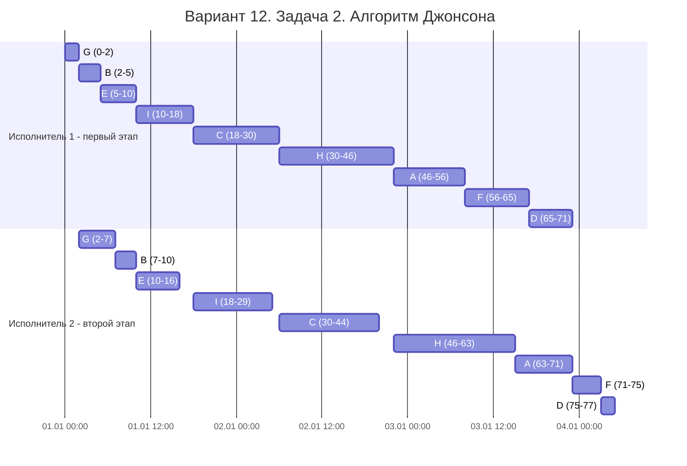

# Задание №8. Вариант 12

## Задача 1. Ленточная стратегия

### Условие и выбор метода

Даны 8 независимых заданий и 5 универсальных исполнителей. Прерывания допускаются. Нужно выполнить все задания за минимальное время.

| Задание | A | B | C | D | E | F | G | H |
| --- | --- | --- | --- | --- | --- | --- | --- | --- |
| Длительность | 14 | 8 | 7 | 6 | 5 | 4 | 3 | 3 |

Здесь исполнители могут выполнять любые задания, задачи независимы и разрешено прерывать работу. Это **вторая модельная задача**, поэтому используем **ленточную стратегию**. При этом два исполнителя не могут одновременно выполнять одно и то же задание.

### Шаг 1. Найдём минимальную длительность

Для этой задачи используем формулу:

$$T_{\text{опт}}=\max\left(\max_i t_i,\frac{\sum_i t_i}{m}\right).$$

Сумма длительностей: $14+8+7+6+5+4+3+3=50$. Самое долгое задание — $A$ (14 единиц), исполнителей $m=5$.

$$T_{\text{опт}}=\max\left(14,\frac{50}{5}\right)=\max(14,10)=14.$$

Короче 14 единиц не получится: задание $A$ само длится 14 единиц, а одновременно выполнять одно задание двумя исполнителями нельзя.

### Шаг 2. Составим ленту и разделим её

Задания располагаем **в исходном порядке**: $A, B, C, D, E, F, G, H$. По ленте они занимают следующие отрезки:

| Задание | Отрезок ленты |
| --- | --- |
| A | 0–14 |
| B | 14–22 |
| C | 22–29 |
| D | 29–35 |
| E | 35–40 |
| F | 40–44 |
| G | 44–47 |
| H | 47–50 |

Нарезаем ленту на отрезки длиной 14 (последний может быть короче):

| Исполнитель | Фрагмент ленты | Что получает |
| --- | --- | --- |
| 1 | 0–14 | A (14) |
| 2 | 14–28 | B (8), C (6) |
| 3 | 28–42 | C (1), D (6), E (5), F (2) |
| 4 | 42–50 | F (2), G (3), H (3) |
| 5 | — | Заданий нет |

### Нарезка ленты на отрезки по 14

Каждая строка — один отрезок ленты. Горизонтальная шкала показывает расстояние **от начала этого отрезка**, поэтому для каждой строки отсчёт начинается с 0. Первые три отрезка имеют длину 14, последний — 8.

```mermaid
gantt
    title Задача 1. Нарезка ленты по 14 единиц
    dateFormat HH:mm
    axisFormat %H:%M
    tickInterval 2hour
    todayMarker off
    section Отрезок 1 (0-14)
    A (14) :r1_a, 00:00, 14h
    section Отрезок 2 (14-28)
    B (8) :r2_b, 00:00, 8h
    C (6) :r2_c, 08:00, 6h
    section Отрезок 3 (28-42)
    C (1) :r3_c, 00:00, 1h
    D (6) :r3_d, 01:00, 6h
    E (5) :r3_e, 07:00, 5h
    F (2) :r3_f, 12:00, 2h
    section Отрезок 4 (42-50)
    F (2) :r4_f, 00:00, 2h
    G (3) :r4_g, 02:00, 3h
    H (3) :r4_h, 05:00, 3h
```

### Шаг 3. Составим расписание

| Исполнитель | Работа и время | Простой |
| --- | --- | --- |
| 1 | A: 0–14 | Нет |
| 2 | B: 0–8; C: 8–14 | Нет |
| 3 | C: 0–1; D: 1–7; E: 7–12; F: 12–14 | Нет |
| 4 | F: 0–2; G: 2–5; H: 5–8 | 8–14 |
| 5 | — | 0–14 |

### Диаграмма Ганта 

Условные единицы показаны как часы, отсчёт начинается с 00:00. 

```mermaid
gantt
    title Вариант 12. Задача 1. Ленточная стратегия
    dateFormat HH:mm
    axisFormat %H:%M
    tickInterval 2hour
    todayMarker off
    section Исполнитель 1
    A (0-14) :p1_A, 00:00, 14h
    section Исполнитель 2
    B (0-8) :p2_B, 00:00, 8h
    C (фрагмент 6 из 7; 8-14) :p2_C, 08:00, 6h
    section Исполнитель 3
    C (фрагмент 1 из 7; 0-1) :p3_C, 00:00, 1h
    D (1-7) :p3_D, 01:00, 6h
    E (7-12) :p3_E, 07:00, 5h
    F (фрагмент 2 из 4; 12-14) :p3_F, 12:00, 2h
    section Исполнитель 4
    F (фрагмент 2 из 4; 0-2) :p4_F, 00:00, 2h
    G (2-5) :p4_G, 02:00, 3h
    H (5-8) :p4_H, 05:00, 3h
```

**Ответ:** минимальная длительность расписания — **14 условных единиц**. Пятый исполнитель простаивает полностью, но это не мешает оптимальности: длительность всё равно ограничена заданием $A$.

### Пример из предметной области

В качестве примера можно рассмотреть работу менеджеров компании над отчётами. Каждый менеджер может работать с любым отчётом, при этом выполнение работы можно прерывать и передавать другому менеджеру. Однако два менеджера не могут одновременно редактировать один отчёт, так как это может привести к ошибкам и некорректности данных. Необходимо распределить работу между менеджерами так, чтобы все отчёты были готовы за минимальное время.
---

## Задача 2. Алгоритм Джонсона

### Условие и выбор метода

Даны 9 независимых заданий, в каждом два последовательных этапа. Первый исполнитель делает только первый этап, второй — только второй. Прерывать этап нельзя. Нужна минимальная общая длительность.

| Этап | A | B | C | D | E | F | G | H | I |
| --- | --- | --- | --- | --- | --- | --- | --- | --- | --- |
| Первый этап $a_i$ | 10 | 3 | 12 | 6 | 5 | 9 | 2 | 16 | 8 |
| Второй этап $b_i$ | 8 | 3 | 14 | 2 | 6 | 4 | 5 | 17 | 11 |

Это **первая модельная (конвейерная) задача**: два специализированных исполнителя, последовательность этапов фиксирована, прерывания запрещены. Поэтому применяем **алгоритм Джонсона**.

### Шаг 1. Разделим задания на две группы

В первую группу относим задания с $a_i \le b_i$, во вторую — с $a_i>b_i$.

| Задание | $a_i$ | $b_i$ | Группа |
| --- | --- | --- | --- |
| A | 10 | 8 | 2 |
| B | 3 | 3 | 1 |
| C | 12 | 14 | 1 |
| D | 6 | 2 | 2 |
| E | 5 | 6 | 1 |
| F | 9 | 4 | 2 |
| G | 2 | 5 | 1 |
| H | 16 | 17 | 1 |
| I | 8 | 11 | 1 |

**Группа 1:** B, C, E, G, H, I. **Группа 2:** A, D, F.

### Шаг 2. Отсортируем группы и получим порядок

Задания группы 1 сортируем **по возрастанию $a_i$**: G (2), B (3), E (5), I (8), C (12), H (16).

Задания группы 2 сортируем **по убыванию $b_i$**: A (8), F (4), D (2).

После объединения групп получаем порядок: **G → B → E → I → C → H → A → F → D**.

### Диаграмма Ганта (Mermaid)

Для диаграммы одна условная единица принята за один час. Используется **условная дата начала 01.01.2026 00:00**. На самих блоках показаны интервалы $t$ от начала 0. 

Первый исполнитель выполняет задания подряд без простоев. Второй начинает свой этап только тогда, когда **первый уже закончил соответствующее задание** и сам второй исполнитель освободился.

У первого исполнителя все задания занимают 71 единицу, он работает с 0 до 71. У второго сумма длительностей этапов равна 70 и он простаивает в интервалах **0–2, 16–18, 29–30, 44–46** (всего 7 единиц). Значит, общая длительность равна $70+7=77$ условных единиц. После 71 первый исполнитель свободен, а второй заканчивает последнюю работу в момент 77.

**Ответ:** оптимальная последовательность — **G, B, E, I, C, H, A, F, D**; минимальная длительность — **77 условных единиц**.

### Пример из предметной области

Мастерская изготавливает девять партий деревянных сувениров ($A$–$I$). Сначала первый специализированный станок вырезает заготовки, затем второй наносит гравировку. Вторую операцию для партии нельзя начать до окончания первой, каждый станок выполняет только одну операцию за раз, прерывать начатую операцию нельзя. Партии не зависят друг от друга. Нужно подобрать порядок изготовления, чтобы все партии были готовы как можно раньше — это конвейерная задача.

---

## Итог

| Задача | Алгоритм | Минимальная длительность |
| --- | --- | --- |
| 1 | Ленточная стратегия | 14 |
| 2 | Алгоритм Джонсона | 77 |
