# Задание №8

## Оптимальное расписание: конвейерная задача и ленточная стратегия

Вариант 13, команда Invariant

## Задача 1. Конвейерная задача

Даны 9 независимых заданий из двух последовательных этапов и 2 исполнителя. Первый исполнитель выполняет только первые этапы, второй только вторые. Прерывания запрещены. Нужно выполнить все задания за минимальное время.

| | $A$ | $B$ | $C$ | $D$ | $E$ | $F$ | $G$ | $H$ | $I$ |
| --- | :---: | :---: | :---: | :---: | :---: | :---: | :---: | :---: | :---: |
| Первый этап | 4 | 16 | 6 | 1 | 13 | 3 | 12 | 8 | 7 |
| Второй этап | 8 | 16 | 1 | 3 | 9 | 4 | 15 | 5 | 7 |

### 1. Выбор алгоритма

Сравним условие с первой модельной задачей.

| № | Характеристика | В условии | В первой модельной задаче |
| :---: | --- | --- | --- |
| 1 | Количество заданий | 9 заданий, от $A$ до $I$ | произвольно |
| 2 | Длительности заданий | у каждого задания два последовательных этапа со своими длительностями | два последовательных этапа произвольной длительности |
| 3 | Одновременное выполнение | задания независимы, но каждый этап выполняет только свой исполнитель | задания независимы |
| 4 | Прерывания | запрещены | запрещены |
| 5 | Количество исполнителей | 2 | строго 2 |
| 6 | Универсальность исполнителей | первый выполняет только первые этапы, второй только вторые | первый выполняет только первые этапы, второй только вторые |
| 7 | Производительность, оплата труда | не заданы | не учитываются |
| 8 | Какое расписание нужно | кратчайшее | кратчайшее |

Условия первой модельной задачи выполнены. Исполнителей ровно два, у каждого своя работа, а второй этап начинается после первого. Применим **алгоритм Джонсона**. Он дает оптимальный порядок заданий и работает быстро, потому что вместо перебора всех $9! = 362880$ порядков достаточно разбить задания на две группы и отсортировать их.

### 2. Применение алгоритма Джонсона

Обозначим длительности этапов задания $i$ через $a_i$ и $b_i$. В записи $i(a_i, b_i)$ первым стоит время первого этапа.

**Шаг 1. Разобьем задания на две группы.** В первую отнесем задания с $a_i \le b_i$, а во вторую задания с $a_i \gt b_i$.

- Первая группа: $A(4, 8)$, $B(16, 16)$, $D(1, 3)$, $F(3, 4)$, $G(12, 15)$, $I(7, 7)$.
- Вторая группа: $C(6, 1)$, $E(13, 9)$, $H(8, 5)$.

У $B$ и $I$ этапы равны, поэтому по выбранному правилу оба задания идут в первую группу.

**Шаг 2. Найдем порядок.** Первую группу сортируем по возрастанию $a_i$. Значения $1, 3, 4, 7, 12, 16$ дают порядок $D, F, A, I, G, B$. Во второй группе сортируем по убыванию $b_i$. Значения $9, 5, 1$ дают $E, H, C$. Соединяем группы и получаем порядок.

$$
D \to F \to A \to I \to G \to B \to E \to H \to C
$$

Первым идет $D$, у которого первый этап занимает всего 1 единицу. Поэтому второй исполнитель получает работу уже в момент 1. Последним оказывается $C$ со вторым этапом длины 1.

**Шаг 3. Построим расписание.** Первый исполнитель работает подряд, без пауз. Второй исполнитель может взять задание, только когда оно уже прошло первый этап, а сам он закончил предыдущее. Второй этап начинается сразу, как только произошло и то и другое. Интервал $[s, e)$ означает работу с момента $s$ до момента $e$.

| Задание | Первый этап | Второй исполнитель свободен с момента | Второй этап | Что происходит |
| :---: | :---: | :---: | :---: | --- |
| $D$ | $[0, 1)$ | 0 | $[1, 4)$ | второй исполнитель простаивает на $[0, 1)$ |
| $F$ | $[1, 4)$ | 4 | $[4, 8)$ | второй этап начинается сразу |
| $A$ | $[4, 8)$ | 8 | $[8, 16)$ | второй этап начинается сразу |
| $I$ | $[8, 15)$ | 16 | $[16, 23)$ | задание ждет на $[15, 16)$ |
| $G$ | $[15, 27)$ | 23 | $[27, 42)$ | второй исполнитель простаивает на $[23, 27)$ |
| $B$ | $[27, 43)$ | 42 | $[43, 59)$ | второй исполнитель простаивает на $[42, 43)$ |
| $E$ | $[43, 56)$ | 59 | $[59, 68)$ | задание ждет на $[56, 59)$ |
| $H$ | $[56, 64)$ | 68 | $[68, 73)$ | задание ждет на $[64, 68)$ |
| $C$ | $[64, 70)$ | 73 | $[73, 74)$ | задание ждет на $[70, 73)$ |

Например, после $I$ второй исполнитель свободен с момента 23, но первый этап $G$ заканчивается только в 27. Поэтому на $[23, 27)$ получается простой. У задания $E$, наоборот, первый этап готов в 56, а второй исполнитель занят до 59, так что ждет уже задание.

### 3. Длительность расписания

Сумма первых этапов равна

$$
4 + 16 + 6 + 1 + 13 + 3 + 12 + 8 + 7 = 70.
$$

Первый исполнитель занят до момента 70. Второй в это время еще выполняет $H$, а затем $C$, и заканчивает в 74. Значит, от окончания работы первого исполнителя до конца расписания проходит еще 4 единицы.

$$
70 + 4 = 74.
$$

Проверим по второму исполнителю. Его работа занимает $8 + 16 + 1 + 3 + 9 + 4 + 15 + 5 + 7 = 68$, а на простои уходит $1 + 4 + 1 = 6$. Получаем те же $68 + 6 = 74$. Порядок выбран по алгоритму Джонсона, поэтому это минимальная длительность.

### 4. Диаграмма Ганта

В каждой строке показана работа одного исполнителя. Пустые промежутки в строке означают простои.

```mermaid
---
displayMode: compact
config:
  gantt:
    leftPadding: 110
---
gantt
    title Конвейерная задача
    dateFormat x
    axisFormat %-L
    tickInterval 5millisecond
    todayMarker off
    section Исполнитель 1
    D :d1, 0, 1
    F :f1, 1, 4
    A :a1, 4, 8
    I :i1, 8, 15
    G :g1, 15, 27
    B :b1, 27, 43
    E :e1, 43, 56
    H :h1, 56, 64
    C :c1, 64, 70
    section Исполнитель 2
    D :d2, 1, 4
    F :f2, 4, 8
    A :a2, 8, 16
    I :i2, 16, 23
    G :g2, 27, 42
    B :b2, 43, 59
    E :e2, 59, 68
    H :h2, 68, 73
    C :c2, 73, 74
```

**Ответ:** 74 условные единицы. Порядок заданий $D, F, A, I, G, B, E, H, C$.

### 5. Интерпретация. Переезд баз данных на новый сервер

В электробусном парке ночью переносят на новый сервер девять баз данных, среди них расписание рейсов, данные диспетчерской и билетная система. Для каждой базы нужно сначала сделать выгрузку на старом сервере, затем восстановить ее на новом. Список баз известен заранее, порядок переноса можно выбирать.

Старый сервер занимается только выгрузкой, а новый только восстановлением. По регламенту каждый обрабатывает одну базу за раз, начатую операцию доводят до конца. Прерванную операцию пришлось бы запускать заново. Восстановление можно начать лишь после того, как файл выгрузки полностью готов, потому что сначала его сверяют по контрольной сумме. Пока новый сервер занят, файлы ждут в общем хранилище. Места в нем хватает, а время передачи и проверки файлов включено в длительности этапов.

Выгрузка и восстановление могут занимать разное время. При выгрузке данные сжимаются, а это медленно, поэтому выгрузка тем дольше, чем больше данных в базе. Распаковка идет быстрее, и восстановление в основном тратит время на индексы, которые новый сервер строит заново. Например, база $D$ выгружается за 1 единицу и восстанавливается за 3, а архив $C$ с небольшим числом индексов выгружается за 6 и восстанавливается за 1.

Сами базы переносятся независимо, но системы парка запускают вместе после завершения всего переноса. Поэтому нужно сократить время до восстановления последней базы. Найденное расписание дает 74 единицы. Старый сервер заканчивает выгрузки в 70, новый завершает последнее восстановление в 74. Первой выгружается база $D$, поэтому новый сервер получает работу уже в момент 1. Дальше он простаивает только дважды. Сначала 4 единицы ждет выгрузку $G$, потом 1 единицу ждет выгрузку $B$. Файлы баз $I$, $E$, $H$ и $C$, наоборот, какое-то время ждут в хранилище, пока новый сервер занят. Последней идет база $C$ с самым коротким восстановлением, чтобы после окончания выгрузок новому серверу оставалось как можно меньше работы.

## Задача 2. Ленточная стратегия

Даны 6 независимых заданий и 3 универсальных исполнителя. Прерывания допускаются. Длительности заданий $A, B, C, D, E, F$ равны 10, 9, 8, 7, 6 и 5. Нужно выполнить все задания за минимальное время.

### 1. Выбор алгоритма

Здесь сравним условие со второй модельной задачей.

| № | Характеристика | В условии | Во второй модельной задаче |
| :---: | --- | --- | --- |
| 1 | Количество заданий | 6 заданий, от $A$ до $F$ | произвольно |
| 2 | Длительности заданий | у каждого задания своя длительность | у каждого задания своя длительность |
| 3 | Одновременное выполнение | задания независимы | задания независимы, их можно выполнять одновременно |
| 4 | Прерывания | допускаются | разрешены, задание можно продолжить с того же места любым исполнителем |
| 5 | Количество исполнителей | 3 | произвольно, но фиксировано |
| 6 | Универсальность исполнителей | универсальны | универсальны, каждый может выполнять любое задание |
| 7 | Производительность, оплата труда | не заданы | не учитываются |
| 8 | Какое расписание нужно | кратчайшее | кратчайшее |

Для этой модели подходит **ленточная стратегия**. Любой исполнитель может продолжить прерванное задание, но выполнять одно задание вдвоем одновременно нельзя. Стратегия дает расписание минимальной длины $T_{opt}$. Для построения нужно найти сумму и максимум длительностей, затем один раз пройти по ленте, так что алгоритм эффективен.

### 2. Применение ленточной стратегии

**Шаг 1. Найдем длину расписания.** Для длительностей $t_1, \dots, t_n$ и $k$ исполнителей используем формулу

$$
T_{opt} = \max\left\lbrace t_1, \dots, t_n, \frac{t_1 + \dots + t_n}{k} \right\rbrace.
$$

В нашем случае самое длинное задание занимает 10 единиц, а сумма длительностей равна $10 + 9 + 8 + 7 + 6 + 5 = 45$. При $k = 3$ получаем

$$
T_{opt} = \max\left\lbrace 10, \frac{45}{3} \right\rbrace = 15.
$$

Обе оценки имеют простой смысл. Одно задание нельзя выполнить быстрее его длительности, а всю работу нельзя закончить быстрее, чем за $45 / 3 = 15$. Здесь определяющей оказалась средняя загрузка. Заданий длиннее 15 нет, поэтому можно резать ленту на части длины 15.

**Шаг 2. Запишем задания на ленту.** Возьмем порядок из условия, то есть $A, B, C, D, E, F$. Общая длина ленты равна 45.

| Задание | $A$ | $B$ | $C$ | $D$ | $E$ | $F$ |
| --- | :---: | :---: | :---: | :---: | :---: | :---: |
| Длительность | 10 | 9 | 8 | 7 | 6 | 5 |
| Место на ленте | $[0, 10)$ | $[10, 19)$ | $[19, 27)$ | $[27, 34)$ | $[34, 40)$ | $[40, 45)$ |

**Шаг 3. Разрежем ленту.** Три части длины 15 получаются при разрезах в точках 15 и 30. Первый разрез проходит внутри $B$ и оставляет части длины $15 - 10 = 5$ и $19 - 15 = 4$. Второй разрез проходит внутри $D$ и дает части $30 - 27 = 3$ и $34 - 30 = 4$. Значит, прерывания будут у заданий $B$ и $D$.

**Шаг 4. Распределим части между исполнителями.** Каждый начинает свою часть ленты с момента 0. У второй части для этого вычитаем из координат 15, у третьей вычитаем 30.

| Исполнитель | Часть ленты | Что и когда выполняет |
| :---: | :---: | --- |
| Первый | $[0, 15)$ | $A$ на $[0, 10)$, часть $B$ длиной 5 на $[10, 15)$ |
| Второй | $[15, 30)$ | часть $B$ длиной 4 на $[0, 4)$, $C$ на $[4, 12)$, часть $D$ длиной 3 на $[12, 15)$ |
| Третий | $[30, 45)$ | часть $D$ длиной 4 на $[0, 4)$, $E$ на $[4, 10)$, $F$ на $[10, 15)$ |

Проверим разрезанные задания. По времени $B$ сначала выполняет второй исполнитель на $[0, 4)$, а потом первый на $[10, 15)$. Части не пересекаются и дают в сумме $4 + 5 = 9$. У $D$ части идут на $[0, 4)$ у третьего и на $[12, 15)$ у второго, всего $4 + 3 = 7$. Прервано два задания, то есть не больше $k - 1 = 2$.

Все три исполнителя заняты с 0 до 15 без простоев и выполняют $3 \cdot 15 = 45$ единиц работы. Если бы мы записали на ленту порядок $A, F, B, E, C, D$, разрезы прошли бы по границам заданий и прерывания не понадобились бы. Но порядок из условия тоже дает минимальную длину, а число прерываний в критерий не входит.

### 3. Длительность расписания

Все задания закончены в момент 15. Полученная длительность совпадает с $T_{opt}$, поэтому расписание кратчайшее.

### 4. Диаграмма Ганта

Задания $B$ и $D$ показаны в двух строках, потому что каждое из них после прерывания продолжает другой исполнитель.

```mermaid
---
displayMode: compact
config:
  gantt:
    leftPadding: 110
---
gantt
    title Ленточная стратегия
    dateFormat x
    axisFormat %-L
    tickInterval 1millisecond
    todayMarker off
    section Исполнитель 1
    A :a1, 0, 10
    B :b1, 10, 15
    section Исполнитель 2
    B :b2, 0, 4
    C :c2, 4, 12
    D :d2, 12, 15
    section Исполнитель 3
    D :d3, 0, 4
    E :e3, 4, 10
    F :f3, 10, 15
```

**Ответ:** 15 условных единиц. Распределение заданий между исполнителями показано на диаграмме.

### 5. Интерпретация. Ночная зарядка электробусов

В том же парке ночью нужно зарядить шесть электробусов на трех одинаковых станциях. Все автобусы уже вернулись с линии, но остаток заряда у них разный. Для зарядки автобуса $A$ требуется 10 единиц времени, для автобуса $B$ требуется 9 и так далее. Любая станция подходит любому автобусу. Закончить зарядку всего парка нужно как можно раньше, чтобы до утреннего выпуска остался запас на случай сбоя станции.

Для модели считаем мощность зарядки постоянной, потому что автобусы заряжают до рабочего уровня, при котором она еще не снижается. Зарядку можно остановить и продолжить позже, в том числе на другой станции; уже накопленная энергия сохраняется. В каждый момент станция подключена только к одному автобусу, а автобус только к одной станции, потому что у станции один кабель, а у автобуса один разъем. Кабели дотягиваются до всех мест стоянки, поэтому перегонять автобусы не требуется. Временем переподключения пренебрегаем.

По нашему расписанию автобус $B$ заряжается у второй станции с 0 до 4, затем ждет и получает оставшийся заряд у первой станции с 10 до 15. Автобус $D$ сначала заряжается у третьей станции, потом у второй. При этом каждая станция занята все 15 единиц времени.

Нижние оценки здесь тоже понятны. Автобусу $A$ в любом случае нужно 10 единиц, поскольку две станции не могут заряжать его одновременно. А суммарно требуется 45 единиц работы станций, значит, трем станциям понадобится как минимум $45 / 3 = 15$. Построенное расписание достигает этой оценки.
