# Команда Problems - Задание 8 Вариант 2:

## **Задача 1. Ленточная стратегия** 

Имеется 6 независимых заданий и 4 универсальных исполнителя. Прерывания допускаются.

Длительности заданий:

| | $A$ | $B$ | $C$ | $D$ | $E$ | $F$ |
| --- | :---: | :---: | :---: | :---: | :---: | :---: |
| Длительность | 12 | 6 | 5 | 4 | 3 | 2 |

Постройте расписание выполнения всех заданий в кратчайшие сроки.

### 1. Выбрать алгоритм решения и обосновать выбор, сопоставив условие с постановкой соответствующей модельной задачи.

Условия задачи соответствуют критериям постановки модельной задачи на ленточную стратегию:
1. Количество заданий произвольно. - Да $(6)$
2. Каждое задание имеет свою длительность. - Да
3. Задания независимы (их можно выполнять одновременно). - Да
4. Прерывания разрешены. - Да
5. Количество исполнителей произвольно, но фиксировано. - Да $(4)$
6. Исполнители универсальны: каждый может выполнять любое задание. - Да
7. Производительность исполнителей, оплата труда и т.п. не учитываются. - Да
8. Требуется построить расписание выполнения всех заданий в кратчайшие сроки. - Да

Для решения задачи с данной постановкой применяется ленточная стратегия.

### 2. Применить выбранный алгоритм

Аналитически найдём оптимальное время для расписания по формуле:

$$
T_{opt}=max \lbrace t_1, ..., t_n, \frac{t_1+...+t_n}{k} \rbrace
$$

Вычислим среднее время:

$$
\frac{12 + 6 + 5 + 4 + 3 + 2}{4} = \frac{32}{4} = 8
$$

Вычислим оптимальное время для расписания:

$$
T_{opt} = max \lbrace 12, 6, 5, 4, 3, 2, 8 \rbrace = 12
$$

Все задания по порядку разделяем на фрагменты длительностью оптимального времени $12$, получаем:
1. $A = 12$
2. $B = 6, C = 5, D = 1$
3. $D = 3, E = 3, F = 2$

### 3. Указать длительность полученного расписания.
Длительность полученного расписания равна оптимальному времени $T_{opt}=12$.

Меньше быть не может, поскольку одно задание $(A)$ нельзя выполнять параллельно разными исполнителями в одно время.

### 4. Вывести расписание в виде диаграммы Ганта.

```mermaid
gantt
    title Задача 1 - Диаграмма Ганта
    todayMarker off
    dateFormat HH:mm
    axisFormat %H:%M
    section Исполнитель 1
    A :a1, 00:00, 12h
    section Исполнитель 2
    B :b1, 00:00, 6h
    C :c1, after b1, 5h
    D :d1, after c1, 1h 
    section Исполнитель 3
    D :d1, 00:00, 3h
    E :e1, after d1, 3h
    F :f1, after e1, 2h
    Простой :crit, after f1, 4h
    section Исполнитель 4
    Простой :crit, 00:00, 12h
```

Прерывание произошло в задании $D$.

Простой исполнителей:
- Исполнитель 3: 4 у.е.
- Исполнитель 4: 12 у.е. 

### 5. Придумать интерпретацию заданных условий из какой-либо предметной области, соответствующую постановке задачи и её смыслу.

Оцифровка книг в библиотеке. Может быть произвольное количество сканеров, но каждую книгу одновременно можно сканировать только на одном любом сканере. Прерывания также допустимы, так как можно продолжить с последней страницы на новом устройстве, но длительность будет так и так зависеть от среднего времени, либо от самой длиной книги. Если книгу отсканировать занимает 10 минут, минимум 10 минут будут работать сколько угодно сканеров.

## **Задача 2. Конвейерная задача** 
Имеется 8 независимых заданий, каждое из которых состоит из двух последовательных этапов, и 2 исполнителя: первый выполняет только первый этап каждого задания, второй — только второй. Прерывания запрещены.

Длительности этапов:

| | $A$ | $B$ | $C$ | $D$ | $E$ | $F$ | $G$ | $H$ |
| --- | :---: | :---: | :---: | :---: | :---: | :---: | :---: | :---: |
| Первый этап | 9 | 2 | 8 | 1 | 4 | 5 | 7 | 13 |
| Второй этап | 11 | 3 | 6 | 4 | 1 | 7 | 4 | 14 |

Постройте расписание выполнения всех заданий в кратчайшие сроки.

### 1. Выбрать алгоритм решения и обосновать выбор, сопоставив условие с постановкой соответствующей модельной задачи.

Условия задачи соответствуют критериям постановки модельной конвейерной задачи:
1. Количество заданий произвольно. - Да $(8)$
2. Каждое задание состоит из двух последовательных этапов, длительности которых
произвольны. - Да
3. Задания независимы. - Да
4. Прерывания запрещены. - Да
5. Количество исполнителей строго равно $2$. - Да
6. Первый исполнитель выполняет только первый этап каждого задания, второй — только
второй этап. - Да
7. Производительность исполнителей, оплата труда и т.п. не учитываются. - Да
8. Требуется построить расписание выполнения всех заданий в кратчайшие сроки - Да

Для решения используем алгоритм Джонсона.

### 2. Применить выбранный алгоритм

Введём обозначения $a_i$ и $b_i$ — длительности первого и второго этапов $i$-го задания.

| | $A$ | $B$ | $C$ | $D$ | $E$ | $F$ | $G$ | $H$ |
| --- | :---: | :---: | :---: | :---: | :---: | :---: | :---: | :---: |
| $a_i$ | 9 | 2 | 8 | 1 | 4 | 5 | 7 | 13 |
| $b_i$ | 11 | 3 | 6 | 4 | 1 | 7 | 4 | 14 |

Разобьём все задания на две группы:
1. В первую группу попадают все задания, у которых $a_i \leq b_i$.
2. Во вторую группу попадают все задания, у которых $a_i > b_i$.

В первую группу входят задания:
- $A: 9 \leq 11$
- $B: 2 \leq 3$
- $D: 1 \leq 4$
- $F: 5 \leq 7$
- $H: 13 \leq 14$

Во вторую группу входят задания:
- $C: 8 > 6$
- $E: 4 > 1$
- $G: 7 > 4$

Отсортируем две группы:
1. Задания из первой группы отсортируем в порядке возрастания величин $a_i$: 

$$
D (1,4) \to B(2,3) \to F(5,7) \to A(9,11) \to H(13,14).
$$

2. Задания из второй группы отсортируем в порядке убывания величин $b_i$:

$$
C(8,6) \to G(7,4) \to E(4,1).
$$

Объединяем в отсортированном порядке сначала задания из первой группы, затем в отсортированном порядке задания из второй группы:

$$
D (1,4) \to B(2,3) \to F(5,7) \to A(9,11) \to H(13,14) \to C(8,6) \to G(7,4) \to E(4,1).
$$

Получаем оптимальный порядок работ. Согласно алгоритму Джонсона, если построить расписание в данном порядке, оно получится кратчайшим.

### 3. Вывести расписание в виде диаграммы Ганта.

```mermaid
gantt
    title Задача 2 - Диаграмма Ганта
    todayMarker off
    dateFormat HH:mm
    axisFormat %H:%M
    section Исполнитель 1
    D :d1, 00:00, 1h
    B :b1, after d1, 2h
    F :f1, after b1, 5h
    A :a1, after f1, 9h
    H :h1, after a1, 13h
    C :c1, after h1, 8h
    G :g1, after c1, 7h
    E :e1, after g1, 4h
    Простой :crit, after e1, 6h
    section Исполнитель 2
    Простой :crit, 00:00, 1h
    D :d2, after d1, 4h
    B :b2, after d2, 3h
    F :f2, after b2, 7h
    Простой :crit, after f2, 2h
    A :a2, after a1, 11h
    Простой :crit, after a2, 2h
    H :h2, after h1, 14h
    C :c2, after h2, 6h
    G :g2, after c2, 4h
    E :e2, after g2, 1h
```

Простои:
- Исполнитель 1: $49$ у.е. $-$ $55$ у.е.
- Исполнитель 2: $0$ у.е. $-$ $1$ у.е., $15$ у.е. $-$ $17$ у.е., $28$ у.е. $-$ $30$ у.е.

### 4. Указать длительность полученного расписания.
Длительность полученного расписания равна сумме величин $a_i$ и времени простоя первого исполнителя:

$$
1 + 2 + 5 + 9 + 13 + 8 + 7 + 4 + 6 = 55 \text{ у.е.}
$$

### 5. Придумать интерпретацию заданных условий из какой-либо предметной области, соответствующую постановке задачи и её смыслу.

Жизненный цикл разработки ПО: Разработчик (1 работник) последовательно реализует определенные модули и код, только после готовности которых тестировщик (2 работник) может начать их проверять.

Этот вариант для предметной области не скопирован, его предложил участник нашей команды (Problems) во время лекции по теме в чате.

# Ответ

## Задача 1.

Минимально возможная длительность расписания составляет $12$ у.е.

Расписание представлено на диаграмме Ганта в пункте [Задача 1.4.](#4-вывести-расписание-в-виде-диаграммы-ганта)

## Задача 2.

Минимально возможная длительность расписания составляет $55$ у.е.

Расписание представлено на диаграмме Ганта в пункте [Задача 2.3.](#3-вывести-расписание-в-виде-диаграммы-ганта)
