# Команда Problems — Задание 8, Вариант 10

## **Задача 1. Ленточная стратегия**

Имеется 7 независимых заданий и 3 универсальных исполнителя. Прерывания допускаются.

Длительности заданий:

| | $A$ | $B$ | $C$ | $D$ | $E$ | $F$ | $G$ |
| --- | :---: | :---: | :---: | :---: | :---: | :---: | :---: |
| Длительность | 18 | 8 | 6 | 4 | 3 | 2 | 1 |

Постройте расписание выполнения всех заданий в кратчайшие сроки.

### 1. Выбрать алгоритм решения и обосновать выбор, сопоставив условие с постановкой соответствующей модельной задачи.

Сопоставим условие с восемью критериями модельной задачи, для которой применяется ленточная стратегия:

1. Количество заданий произвольно. — Да $(7)$.
2. Каждое задание имеет свою длительность. — Да: $18, 8, 6, 4, 3, 2, 1$.
3. Задания независимы (их можно выполнять одновременно). — Да: в условии прямо сказано «независимых».
4. Прерывания разрешены. — Да: прямо сказано в условии.
5. Количество исполнителей произвольно, но фиксировано. — Да $(3)$.
6. Исполнители универсальны: каждый может выполнять любое задание. — Да: прямо сказано в условии.
7. Производительность исполнителей, оплата труда и т. п. не учитываются. — Да: в условии нет никаких различий между исполнителями.
8. Требуется построить расписание выполнения всех заданий в кратчайшие сроки. — Да.

Все восемь критериев выполнены, поэтому условие совпадает с постановкой модельной задачи, для которой существует эффективный алгоритм, — **ленточной стратегией**. Это не конвейерная задача: у заданий нет двух этапов, исполнители не привязаны к этапам, а прерывания разрешены.

### 2. Применить выбранный алгоритм

Ленточная стратегия состоит из двух частей: сначала оптимальная длительность расписания находится **аналитически**, потом по ней из «ленты» заданий нарезаются фрагменты для исполнителей.

**Шаг 1. Оптимальная длительность расписания.**

$$
T_{opt}=\max \left\lbrace t_1, \dots, t_n, \frac{t_1+\dots+t_n}{k} \right\rbrace,
$$

где $t_i$ — длительности заданий, $k$ — число исполнителей. Делим сумму именно на число **исполнителей** $k=3$, а не на число заданий.

Сумма длительностей:

$$
18 + 8 + 6 + 4 + 3 + 2 + 1 = 42.
$$

Среднее время на одного исполнителя:

$$
\frac{42}{3} = 14.
$$

Оптимальное время:

$$
T_{opt} = \max \lbrace 18, 8, 6, 4, 3, 2, 1, 14 \rbrace = 18.
$$

Максимум достигается на самом длинном задании: $t_A = 18 > 14$. Значит, расписание не может быть короче $18$. Задание $A$ нельзя выполнять параллельно разными исполнителями в один момент времени, а среднюю загрузку $14$ оно уже превышает.

**Шаг 2. Лента.** Выстраиваем задания в единую ленту в том порядке, в котором они даны, и отмечаем координаты на ленте:

| Задание | $A$ | $B$ | $C$ | $D$ | $E$ | $F$ | $G$ |
| --- | :---: | :---: | :---: | :---: | :---: | :---: | :---: |
| Начало на ленте | 0 | 18 | 26 | 32 | 36 | 39 | 41 |
| Конец на ленте | 18 | 26 | 32 | 36 | 39 | 41 | 42 |

**Шаг 3. Нарезка.** Режем ленту на фрагменты длиной $T_{opt}=18$ — в точках $18$ и $36$. Остаток — «хвост» меньше $18$:

1. Фрагмент $[0;18]$: $A = 18$.
2. Фрагмент $[18;36]$: $B = 8,\ C = 6,\ D = 4$ (всего $8+6+4=18$).
3. Фрагмент $[36;42]$: $E = 3,\ F = 2,\ G = 1$ (всего $6$, это хвост).

Порядок заданий и фрагментов не меняем: ленточная стратегия требует брать задания строго в порядке поступления. Переставлять их ради «красоты» не нужно, потому что длительность от этого не уменьшится.

**Шаг 4. Раздача исполнителям.** Первый фрагмент отдаём первому исполнителю, второй — второму, третий — третьему.

- Исполнитель 1: $A$ в момент времени $[0;18]$.
- Исполнитель 2: $B$ в $[0;8]$, $C$ в $[8;14]$, $D$ в $[14;18]$.
- Исполнитель 3: $E$ в $[0;3]$, $F$ в $[3;5]$, $G$ в $[5;6]$, затем простой $[6;18]$.

Одно и то же задание нигде не выполняется одновременно на двух исполнителях, поэтому расписание допустимо.

### 3. Указать длительность полученного расписания.

Длительность полученного расписания равна оптимальному времени: $T_{opt} = 18$ у.е.

Меньше быть не может по двум причинам:
- задание $A$ длится $18$ и не может выполняться параллельно само с собой;
- при этом $18 > 14$, то есть среднее на исполнителя меньше, чем $A$, и именно $A$ определяет длину расписания.

**Количество прерываний: 0.** Границы фрагментов (моменты $18$ и $36$ на ленте) совпали с границами заданий ($A$ заканчивается ровно на $18$, $D$ — ровно на $36$, потому что $8+6+4=18$). Ни одно задание не разрезано. Прерывания допускаются, но в этом варианте они не понадобились.

### 4. Вывести расписание в виде диаграммы Ганта.

```mermaid
gantt
    title Задача 1 - Диаграмма Ганта (T = 18)
    todayMarker off
    dateFormat HH:mm
    axisFormat %H:%M
    section Исполнитель 1
    A :a1, 00:00, 18h
    section Исполнитель 2
    B :b1, 00:00, 8h
    C :c1, after b1, 6h
    D :d1, after c1, 4h
    section Исполнитель 3
    E :e1, 00:00, 3h
    F :f1, after e1, 2h
    G :g1, after f1, 1h
    Простой :crit, p3, after g1, 12h
```

Расписание в виде таблицы:

| Исполнитель | Задания (интервалы времени) | Простой |
| --- | --- | --- |
| 1 | $A$: $[0;18]$ | — |
| 2 | $B$: $[0;8]$, $C$: $[8;14]$, $D$: $[14;18]$ | — |
| 3 | $E$: $[0;3]$, $F$: $[3;5]$, $G$: $[5;6]$ | $[6;18]$ — $12$ у.е. |

Проверка: суммарная работа $18 + 18 + 6 = 42$, что равно сумме длительностей заданий. Суммарный простой $12 = 3 \cdot 18 - 42$.

### 5. Придумать интерпретацию заданных условий из какой-либо предметной области, соответствующую постановке задачи и её смыслу.

**Запись озвучки анимационного фильма в студии с тремя одинаковыми кабинами.** Единица времени — один час записи.

Задания — роли, которые нужно записать. Длительность задания — сколько часов актёр должен провести у микрофона, чтобы начитать роль. Исполнители — три звукозаписывающие кабины. Цель — записать все роли как можно раньше, чтобы звукорежиссёр начал сведение.

| Роль | $A$ | $B$ | $C$ | $D$ | $E$ | $F$ | $G$ |
| --- | :---: | :---: | :---: | :---: | :---: | :---: | :---: |
| Кто | главный герой | злодей | наставник | друг героя | эпизодический персонаж | второй эпизодический персонаж | массовка |
| Часов записи | 18 | 8 | 6 | 4 | 3 | 2 | 1 |

Как каждая особенность постановки отражается в этой ситуации:

- **Задания независимы.** Каждый актёр записывает свои реплики отдельно, без партнёров по сцене. Реплики партнёров потом сводятся при монтаже, поэтому порядок записи ролей не важен.
- **Прерывания допускаются.** Сессию можно остановить и продолжить в другой кабине: все дубли сохраняются на общем сервере, а прогресс записи роли (сколько часов реплик уже начитано) не теряется.
- **Исполнители универсальны и не различаются.** В каждой кабине одинаковые микрофоны, звукоизоляция и программа записи, поэтому актёру всё равно, в какой кабине работать, и скорость записи от кабины не зависит.
- **Одно задание нельзя выполнять параллельно с самим собой.** Один актёр физически не может одновременно сидеть в двух кабинах. Именно поэтому роль главного героя ($18$ часов) задаёт нижнюю границу длительности всей записи, и никакие дополнительные кабины её не сократят.
- **Число исполнителей фиксировано** — в студии ровно три кабины.
- **Производительность и оплата не учитываются.** Нас интересует только момент, когда будет записана последняя реплика.

Смысл ответа в этой интерпретации задачи: запись займёт $18$ часов, причём четвёртая кабина не ускорила бы работу, а двух кабин не хватило бы ($21$ час).

---

## **Задача 2. Конвейерная задача**

Имеется 10 независимых заданий, каждое из которых состоит из двух последовательных этапов, и 2 исполнителя: первый выполняет только первый этап каждого задания, второй — только второй. Прерывания запрещены.

Длительности этапов:

| | $A$ | $B$ | $C$ | $D$ | $E$ | $F$ | $G$ | $H$ | $I$ | $J$ |
| --- | :---: | :---: | :---: | :---: | :---: | :---: | :---: | :---: | :---: | :---: |
| Первый этап | 2 | 4 | 5 | 9 | 13 | 8 | 7 | 6 | 3 | 10 |
| Второй этап | 3 | 5 | 8 | 9 | 16 | 6 | 2 | 4 | 1 | 7 |

Постройте расписание выполнения всех заданий в кратчайшие сроки.

### 1. Выбрать алгоритм решения и обосновать выбор, сопоставив условие с постановкой соответствующей модельной задачи.

Сопоставим условие с восемью критериями модельной конвейерной задачи:

1. Количество заданий произвольно. — Да $(10)$.
2. Каждое задание состоит из двух последовательных этапов, длительности которых произвольны. — Да: второй этап задания можно начать только после завершения его первого этапа.
3. Задания независимы. — Да: порядок заданий можно выбирать как угодно. Но распараллелить их нельзя: исполнителей ровно два, и каждый привязан к своему этапу.
4. Прерывания запрещены. — Да: прямо сказано в условии.
5. Количество исполнителей строго равно $2$. — Да.
6. Первый исполнитель выполняет только первый этап каждого задания, второй — только второй. — Да: исполнители не универсальны.
7. Производительность исполнителей, оплата труда и т. п. не учитываются. — Да.
8. Требуется построить расписание выполнения всех заданий в кратчайшие сроки. — Да.

Условие совпадает с постановкой конвейерной задачи, поэтому используем **алгоритм Джонсона** — эффективный алгоритм построения расписания минимальной длительности для двух исполнителей.

### 2. Применить выбранный алгоритм

Введём обозначения: $a_i$ — длительность первого этапа $i$-го задания, $b_i$ — длительность второго этапа.

| | $A$ | $B$ | $C$ | $D$ | $E$ | $F$ | $G$ | $H$ | $I$ | $J$ |
| --- | :---: | :---: | :---: | :---: | :---: | :---: | :---: | :---: | :---: | :---: |
| $a_i$ | 2 | 4 | 5 | 9 | 13 | 8 | 7 | 6 | 3 | 10 |
| $b_i$ | 3 | 5 | 8 | 9 | 16 | 6 | 2 | 4 | 1 | 7 |

**Шаг 1. Разбиваем задания на две группы.**

1. В первую группу попадают задания, у которых $a_i \leq b_i$ (первый этап не длиннее второго).
2. Во вторую группу попадают задания, у которых $a_i > b_i$ (первый этап длиннее второго).

Первая группа:
- $A: 2 \leq 3$
- $B: 4 \leq 5$
- $C: 5 \leq 8$
- $D: 9 \leq 9$ (при равенстве задание относим к первой группе)
- $E: 13 \leq 16$

Вторая группа:
- $F: 8 > 6$
- $G: 7 > 2$
- $H: 6 > 4$
- $I: 3 > 1$
- $J: 10 > 7$

**Шаг 2. Сортируем каждую группу отдельно.**

1. Первую группу сортируем по **возрастанию** длительности первого этапа $a_i$:

$$
A(2,3) \to B(4,5) \to C(5,8) \to D(9,9) \to E(13,16).
$$

2. Вторую группу сортируем по **убыванию** длительности второго этапа $b_i$:

$$
J(10,7) \to F(8,6) \to H(6,4) \to G(7,2) \to I(3,1).
$$

**Шаг 3. Объединяем списки.** Сначала идёт отсортированная первая группа, затем отсортированная вторая:

$$
A(2,3) \to B(4,5) \to C(5,8) \to D(9,9) \to E(13,16) \to J(10,7) \to F(8,6) \to H(6,4) \to G(7,2) \to I(3,1).
$$

Получили оптимальный порядок работ: $A, B, C, D, E, J, F, H, G, I$. По алгоритму Джонсона расписание, построенное в этом порядке, имеет минимальную длительность.

**Как запомнить сортировку.** Задания с коротким первым этапом ставим в начало: тогда второй исполнитель дольше всего не простаивает в самом начале (пока первый этап первого задания не завершён, второму нечего делать). Задания с коротким вторым этапом ставим в конец: тогда после того, как первый исполнитель закончил, второй заканчивает как можно быстрее и последний простой первого исполнителя получается минимальным.

**Шаг 4. Строим расписание в этом порядке.** Правило: первый исполнитель берёт следующее задание сразу, как освободился. Второй исполнитель начинает второй этап задания в момент $\max$ (момент, когда он освободился; момент, когда первый исполнитель закончил первый этап этого задания). Если второй исполнитель освободился раньше, чем задание поступило на второй этап, он простаивает. Если, наоборот, задание готово раньше, чем второй исполнитель освободился, готовое задание ждёт (простоя исполнителя при этом нет).

| Задание | Первый этап | Второй исполнитель освободился в | Второй этап | Комментарий |
| --- | :---: | :---: | :---: | --- |
| $A$ | $[0;2]$ | $0$ | $[2;5]$ | второй простаивал $[0;2]$: первому деталей ещё не поступало |
| $B$ | $[2;6]$ | $5$ | $[6;11]$ | второй освободился в $5$, а $B$ готово в $6$: простой $[5;6]$ |
| $C$ | $[6;11]$ | $11$ | $[11;19]$ | $C$ готово в $11$, второй свободен в $11$: без простоя |
| $D$ | $[11;20]$ | $19$ | $[20;29]$ | второй освободился в $19$, $D$ готово в $20$: простой $[19;20]$ |
| $E$ | $[20;33]$ | $29$ | $[33;49]$ | $E$ готово в $33$, второй свободен в $29$: простой $[29;33]$ |
| $J$ | $[33;43]$ | $49$ | $[49;56]$ | $J$ готово в $43$, но второй занят до $49$: $J$ ждёт $[43;49]$ |
| $F$ | $[43;51]$ | $56$ | $[56;62]$ | $F$ ждёт $[51;56]$ |
| $H$ | $[51;57]$ | $62$ | $[62;66]$ | $H$ ждёт $[57;62]$ |
| $G$ | $[57;64]$ | $66$ | $[66;68]$ | $G$ ждёт $[64;66]$ |
| $I$ | $[64;67]$ | $68$ | $[68;69]$ | $I$ ждёт $[67;68]$ |

Простои исполнителей:
- Исполнитель 1: единственный простой в самом конце, $[67;69]$ — $2$ у.е. (после того как он закончил первый этап последнего задания $I$, ему делать нечего).
- Исполнитель 2: $[0;2]$, $[5;6]$, $[19;20]$, $[29;33]$ — всего $2+1+1+4 = 8$ у.е.

### 3. Указать длительность полученного расписания.

Длительность расписания равна сумме длительностей всех первых этапов плюс простой первого исполнителя в конце:

$$
\sum a_i + \text{простой}_1 = (2+4+5+9+13+8+7+6+3+10) + 2 = 67 + 2 = 69 \text{ у.е.}
$$

Проверка вторым способом: длительность равна сумме длительностей всех вторых этапов плюс все простои второго исполнителя:

$$
\sum b_i + \text{простой}_2 = (3+5+8+9+16+6+2+4+1+7) + (2+1+1+4) = 61 + 8 = 69 \text{ у.е.}
$$

Оба способа дают одно и то же число.

**Длительность полученного расписания: $69$ у.е.**

### 4. Вывести расписание в виде диаграммы Ганта.

```mermaid
gantt
    title Задача 2 - Диаграмма Ганта (T = 69)
    todayMarker off
    dateFormat HH:mm
    axisFormat %H:%M
    section Исполнитель 1
    A :a1, 00:00, 2h
    B :b1, after a1, 4h
    C :c1, after b1, 5h
    D :d1, after c1, 9h
    E :e1, after d1, 13h
    J :j1, after e1, 10h
    F :f1, after j1, 8h
    H :h1, after f1, 6h
    G :g1, after h1, 7h
    I :i1, after g1, 3h
    Простой :crit, q1, after i1, 2h
    section Исполнитель 2
    Простой :crit, p0, 00:00, 2h
    A :a2, after p0, 3h
    Простой :crit, p1, after a2, 1h
    B :b2, after p1, 5h
    C :c2, after b2, 8h
    Простой :crit, p2, after c2, 1h
    D :d2, after p2, 9h
    Простой :crit, p3, after d2, 4h
    E :e2, after p3, 16h
    J :j2, after e2, 7h
    F :f2, after j2, 6h
    H :h2, after f2, 4h
    G :g2, after h2, 2h
    I :i2, after g2, 1h
```

Единица времени на диаграмме — один час. Расписание длится $69$ часов, поэтому метки оси после $23{:}59$ начинают счёт заново ($24 \to 00{:}00$, $48 \to 00{:}00$ и т. д.). Точные интервалы заданы в таблице ниже.

| Задание | Исполнитель 1 (первый этап) | Исполнитель 2 (второй этап) |
| --- | :---: | :---: |
| $A$ | $[0;2]$ | $[2;5]$ |
| $B$ | $[2;6]$ | $[6;11]$ |
| $C$ | $[6;11]$ | $[11;19]$ |
| $D$ | $[11;20]$ | $[20;29]$ |
| $E$ | $[20;33]$ | $[33;49]$ |
| $J$ | $[33;43]$ | $[49;56]$ |
| $F$ | $[43;51]$ | $[56;62]$ |
| $H$ | $[51;57]$ | $[62;66]$ |
| $G$ | $[57;64]$ | $[66;68]$ |
| $I$ | $[64;67]$ | $[68;69]$ |
| Простой | $[67;69]$ | $[0;2]$, $[5;6]$, $[19;20]$, $[29;33]$ |

Допустимость: ни одно задание не выполняется на двух исполнителях одновременно, и для каждого задания его второй этап начинается не раньше окончания первого. Например, для $J$ первый этап заканчивается в $43$, а второй начинается в $49$.

### 5. Придумать интерпретацию заданных условий из какой-либо предметной области, соответствующую постановке задачи и её смыслу.

**Подготовка и исследование образцов керна в геологической лаборатории.** Единица времени — один час.

Задания — десять образцов горной породы ($A$–$J$), привезённых с разных скважин. Первый этап — изготовление петрографического шлифа (тонкого прозрачного среза). Его делает единственный препаратор, и длительность $a_i$ зависит от твёрдости породы. Второй этап — исследование шлифа на единственном электронном микроскопе. Его проводит минералог, и длительность $b_i$ зависит от числа минеральных фаз в образце. Цель — исследовать все образцы как можно раньше, чтобы сдать заключение по месторождению.

Как каждая особенность постановки отражается в этой ситуации:

- **Два последовательных этапа.** Исследовать на микроскопе можно только готовый шлиф, а сделать шлиф можно только из того образца, который ещё не исследован. Кроме того, один образец — это один шлиф, и параллельно выполнить оба этапа для него нельзя.
- **Задания независимы.** Образцы взяты из разных скважин, результаты по одному никак не влияют на другой, поэтому очерёдность выбираем свободно.
- **Прерывания запрещены.** Шлиф нужно довести до нужной толщины за одну непрерывную работу: если оторваться, полученный срез уже невозможно «дошлифовать» без искажения структуры породы. Сеанс на микроскопе тоже нельзя прервать: при остановке сбрасываются вакуум и юстировка, и образец придётся устанавливать заново.
- **Ровно два исполнителя, каждый привязан к своему этапу.** Препаратор не допущен к работе на микроскопе, а минералог не владеет шлифовальным станком. Поэтому исполнители не универсальны, и распараллелить работу нельзя.
- **Готовые шлифы ждут в лотке.** Шлиф не портится, и лоток вмещает любое количество шлифов. Поэтому если микроскоп ещё занят, готовый шлиф просто лежит и ждёт, а препаратор сразу берёт следующий образец. Простой возникает только у исполнителя без работы: микроскоп стоит, пока нет готового шлифа.
- **Производительность и оплата не учитываются.** Нас интересует только момент окончания последнего сеанса.

Смысл алгоритма Джонсона в этой ситуации: сначала изготавливаем шлифы для образцов, которые делаются быстро и исследуются долго ($A$, $B$, $C$, $D$, $E$), чтобы микроскоп как можно меньше простаивал в начале и не оставался без шлифов. В конец ставим образцы, которые делаются долго, но исследуются быстро ($J$, $F$, $H$, $G$, $I$): после того как препаратор закончил последний шлиф, микроскопу остаётся поработать как можно меньше.

---

# Ответ

## Задача 1.

Минимально возможная длительность расписания составляет $18$ у.е.

Расписание представлено на диаграмме Ганта в пункте [Задача 1.4.](#4-вывести-расписание-в-виде-диаграммы-ганта)

## Задача 2.

Оптимальный порядок работ (алгоритм Джонсона): $A, B, C, D, E, J, F, H, G, I$.

Минимально возможная длительность расписания составляет $69$ у.е.

Расписание представлено на диаграмме Ганта в пункте [Задача 2.4.](#4-вывести-расписание-в-виде-диаграммы-ганта-1)
